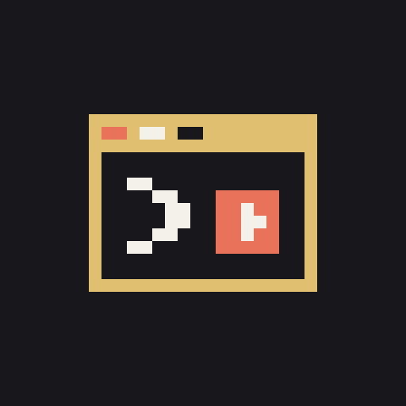

# Arcade for Claude Code — tableros que Claude completa tarjeta a tarjeta

[English](README.md) · [Русский](README.ru.md) · [Українська](README.uk.md) · **Español** · [Français](README.fr.md) · [Deutsch](README.de.md) · [Português](README.pt.md) · [Italiano](README.it.md) · [Polski](README.pl.md) · [Türkçe](README.tr.md) · [日本語](README.ja.md) · [中文](README.zh.md) · [한국어](README.ko.md)

> **Beta.** Todo lo que se describe aquí funciona y se usa a diario. Los informes de errores son muy bienvenidos — consulta [Comentarios](#comentarios).

Pon tus tareas en un tablero y pulsa *Cola para Claude*: Claude toma las tarjetas una a una, marca la lista de tareas y escribe el resultado en la tarjeta — en una sesión o en varias a la vez, y dos sesiones nunca toman la misma tarjeta. *Agentes* muestra todas las sesiones de Claude Code con Arcade en tu ordenador: trabajando, esperando permiso o terminadas. Además hay un cuaderno y un calendario que Claude lleva contigo, tableros y chats compartidos para tu equipo, y juegos, libros y vídeos para la espera. Gratis y de código abierto.

Todo el catálogo es gratuito: los juegos tienen licencias abiertas y los libros y audiolibros son de dominio público. También puedes jugar en línea con otras personas que esperan a sus agentes y chatear con tus amigos.


*Tu tablero: una tarjeta pasa a Claude con un botón, interfaz en inglés. [Ver el vídeo de 31 segundos](https://github.com/user-attachments/assets/c9076e68-2db6-4f68-9d88-8a132ce96f6a).*

**Instalación** — en una terminal:

```
claude plugin marketplace add ArbakovMaxim/agent-arcade
claude plugin install arcade@agent-arcade
```

O dentro de Claude Code: `/plugin marketplace add ArbakovMaxim/agent-arcade` y luego `/plugin install arcade@agent-arcade`. Requiere Claude Code 2.1.275 o posterior. [Más sobre la instalación y las actualizaciones](#instalación)


*Mientras el agente trabaja: 31 segundos en Claude Desktop, con la interfaz en inglés. [Ver el vídeo en 720p](https://github.com/user-attachments/assets/bbb14c28-2813-40c0-82e6-d7375ddc2253).*

## Funciones

- **Cuaderno y tableros de proyectos.** Páginas, subpáginas y listas de tareas que también lleva Claude, y tableros con columnas y tarjetas. *Dar a Claude* le pasa una página o una tarjeta a Claude: marca lo hecho y escribe ahí el resultado. Marca una página o tarjeta como las notas de la carpeta de un proyecto, y cada sesión nueva de Claude Code allí empezará con su texto. Una página o tarjeta muestra su texto con formato, con los botones *Editar* y *Copiar*. Todas tus sesiones abiertas de Claude Code comparten el cuaderno, así que cada una puede tomar su propia tarjeta del mismo tablero. Comparte un tablero con tus amigos y todos trabajáis en el mismo. Envía una página a Notion u otra aplicación, o trae una desde allí, mediante los conectores de Claude; dicta en el cuadro de mensaje de Claude y pasa el texto a una página.
- **Claude avanza por tu tablero.** *Cola para Claude* le pasa a Claude las tarjetas de la primera columna una a una: la siguiente va cuando la anterior está en *Hecho*, y una pregunta de Claude o una tarjeta sin terminar detiene la cola. En una tarjeta hecha ves los archivos que cambió Claude y su diff, y luego la aceptas o la devuelves con un comentario. Las tarjetas tienen fechas de vencimiento que aparecen en el calendario, y en un tablero compartido todos ven quién tomó cada tarjeta. Trae issues de GitHub, Linear, Jira u otro tracker a un tablero como tarjetas y publica el resultado de vuelta como comentario, mediante los conectores de Claude. *Resumen del día* crea una página para el stand-up — qué se pasó a Claude, qué está hecho, qué está en curso — para enviarla al chat de tu equipo.
- **Prompts.** Las peticiones que escribes una y otra vez se convierten en plantillas de una sola pulsación: al pulsar una, va a Claude, como *Dar a Claude*, y *Al cuadro de mensaje* te deja terminarla antes. Comparte un conjunto con tus amigos y todo el equipo tiene los mismos prompts. Claude también guarda plantillas: «guarda esto como prompt en Arcade».
- **Hoy.** La primera ficha de *Trabajo* reúne en una pantalla lo que te espera: sesiones que esperan un permiso o una respuesta (una pregunta con opciones se responde ahí mismo), los eventos de hoy, las tarjetas que vencen hoy o ya vencidas, las tarjetas que tomaste en tableros compartidos, los chats sin leer y una línea con los límites de Claude. Las sesiones que terminaron su turno mientras no estabas tienen su propio bloque, con el comienzo de la respuesta de Claude.
- **Agentes.** *Agentes* en *Trabajo* muestra todas las sesiones de Claude Code con Arcade en este ordenador, por carpeta: si trabaja, trabaja en segundo plano (los subagentes de Claude siguen en marcha), espera permiso, terminó su turno o está libre, y desde hace cuánto, con su tarjeta y su lugar en la cola. Cuando Claude en otra sesión hace una pregunta con opciones, la respondes con un botón en su propia tarjeta. Cuando otra sesión pide permiso o hace una pregunta, te lo dice un aviso en tu propio panel, y una notificación del sistema con sonido te llega aunque Claude Code esté minimizado. La cola de un tablero puede funcionar en varias sesiones a la vez, y dos sesiones no reciben la misma tarjeta. Cada tarjeta muestra también la rama de git y los archivos sin confirmar de la sesión, y avisa cuando dos sesiones editan el mismo archivo. Una sesión que terminó su turno muestra las primeras palabras de la respuesta de Claude, cuándo terminó y cuántos archivos cambió.
- **Límites.** La ficha *Límites* en *Trabajo* muestra las ventanas de límite de Claude — 5 horas, la semana y el límite de gasto — con un porcentaje, una barra y cuándo se reinicia cada una, además del contexto y el coste de esta sesión y de tus otras sesiones. Las cifras vienen del propio Claude Code. Si un límite se agota en medio de la cola de un tablero, un botón la sigue tras el reinicio. Bajo las ventanas de 5 horas y de la semana, una línea dice aproximadamente cuándo se agotará la ventana al ritmo actual.
- **Calendario.** En Desktop, un mes de casillas de día del mismo tamaño con un punto del color de cada evento; en la terminal y VS Code, la lista de lo próximo. Un evento se apunta con una línea, como «fri 9:30 standup», y puede repetirse cada día, los días laborables, cada semana, cada mes o cada año. Elige su color y cuándo avisarte, de una lista o con tus propias palabras (como «45 min before» o «the day before at 20:00»); el recordatorio llega como notificación del sistema. Ahí aparecen también las fechas de vencimiento de las tarjetas de los tableros. Claude también apunta y cambia eventos: «apunta una llamada el viernes a las 15:00». A la hora de un evento, Arcade puede darle a Claude una tarea: la cola de un tablero, una tarjeta, una plantilla o tu propio texto.
- **Amigos y chats.** Un inicio de sesión opcional con GitHub mantiene tus ajustes iguales en todos tus ordenadores y te da un @alias; añade amigos por su alias exacto, mira quién está en línea, comparte tableros, invítalos a jugar y chatea en privado o en grupos.
- **Sabe lo que hace el agente.** Cuando el agente termina o pide permiso, aparece un aviso sobre el juego — sigue jugando, pausa o vuelve directamente al agente (el comportamiento se elige en los ajustes). En Claude Desktop también puede cerrar la pestaña que estás viendo, para que vuelvas a tener la conversación delante.
- **Aparece solo.** Tras 10 segundos de trabajo del agente, Arcade ofrece un juego sobre el prompt —o más tarde, o nunca, como elijas en los ajustes—; nunca roba el foco a menos que se lo pidas.
- **Te acompaña entre sesiones.** Deja abierto el panel de Arcade y cada nueva sesión de Claude Code lo abrirá sola; ciérralo a mano y se quedará cerrado.
- **Un menú, seis secciones.** *Jugar*, *Leer y escuchar*, *Ver*, *Social*, *Trabajo* y *Más* — pliega las que no necesites. Arriba: *Continuar* el último juego, *Buscar* y *Favoritos*. La primera vez que abres Arcade eliges qué secciones mostrar.
- **61 juegos gratuitos** de NES (Dendy), Sega Mega Drive, Master System, PlayStation y una pestaña *Juegos* con juegos arcade, de disparos, carreras, estrategia, aventuras y juegos de mesa.
- **Lee y escucha.** Clásicos y audiolibros de LibriVox en 30 idiomas, directamente de Project Gutenberg, Wikisource y LibriVox, además de artículos y episodios de podcast recientes sobre el tema del trabajo del agente.
- **Mira.** Vídeos recientes de YouTube sobre el tema del trabajo del agente, Twitch: tus propios canales y directos sobre programación, tecnología, ciencia y juegos retro, y TikTok: el feed *Para ti* y la búsqueda en el propio sitio de TikTok, donde inicias sesión tú mismo.
- **NES y Flappy Arcade dentro de Claude Code** — en la terminal, VS Code y Claude Desktop. Todo lo demás se abre en una ventana del navegador; en Claude Desktop, por defecto en el navegador integrado de Claude (los juegos de disparos siguen abriéndose en una ventana del navegador: el navegador integrado no puede capturar el ratón).
- **Juego en línea.** Juegos de consola para dos por red, deathmatch y cooperativo en Doom, ajedrez, go, damas y reversi contra personas o contra la máquina.
- **«Quién espera en línea».** Arcade muestra en Claude Code cuando alguien espera compañero, con un botón *Unirse*.
- **Búsqueda y favoritos.** Una sola búsqueda en juegos y canales de Twitch, agrupada por sección y género; marca un juego con ☆ para guardarlo en *★ Favoritos*.
- **Tus propios juegos.** Añade las ROM que tengas; se quedan en tu equipo.
- **13 idiomas de interfaz:** English, Русский, Українська, Español, Français, Deutsch, Português, Italiano, Polski, Türkçe, 日本語, 中文, 한국어 — según el idioma del sistema o del navegador, inglés por defecto.

## Instalación

Requiere **Claude Code 2.1.275 o posterior**. *Límites* necesita un Claude Code que informe de los límites a los plugins (comprobado en 2.1.302 y 2.1.316); en uno más antiguo, esa pantalla lo dice y el resto de Arcade funciona como siempre.

En una terminal, dos comandos: añade el marketplace de Arcade (este repositorio) y luego instala el plugin desde él:

```
claude plugin marketplace add ArbakovMaxim/agent-arcade
claude plugin install arcade@agent-arcade
```

O dentro de una sesión de Claude Code:

```
/plugin marketplace add ArbakovMaxim/agent-arcade
/plugin install arcade@agent-arcade
```

O en un solo paso, que añade también el marketplace — en una terminal o dentro de una sesión:

```
claude plugin install arcade --marketplace ArbakovMaxim/agent-arcade
```

```
/plugin install arcade --marketplace ArbakovMaxim/agent-arcade
```

El plugin se instala para todas las sesiones y aplicaciones. La extensión de VS Code no tiene el comando `/plugin`: instálalo desde una terminal y la extensión lo cargará en una conversación nueva.

**Actualizar:**

```
/plugin marketplace update agent-arcade
/plugin update arcade@agent-arcade
```

Después reinicia Claude Code. El marketplace descarga solo el plugin —unos pocos MiB, sin el sitio web—, así que actualizar lleva segundos. Si ya tienes Arcade instalado, no tienes que hacer nada: el marketplace se cambia solo en la próxima actualización.

Si `/plugin update` dice *already at the latest version* pero ya salió una versión nueva de Arcade, el marketplace no se actualizó. Para ver por qué, ejecuta `claude plugin marketplace update agent-arcade` en una terminal. Si dice *timed out*, dale 10 minutos a la clonación:

```
CLAUDE_CODE_PLUGIN_GIT_TIMEOUT_MS=600000 claude plugin marketplace update agent-arcade
```

En PowerShell: `$env:CLAUDE_CODE_PLUGIN_GIT_TIMEOUT_MS=600000; claude plugin marketplace update agent-arcade`. Luego vuelve a ejecutar `/plugin update arcade@agent-arcade`.

**Desinstalar:** `/plugin uninstall arcade@agent-arcade`

## Cómo se usa

- **`/arcade`** abre el menú en cualquier momento.
- Deja el panel abierto y las sesiones nuevas lo abrirán solas: en la terminal, al arrancar; en Desktop y VS Code, cuando se conectan a la sesión; el teclado sigue en el prompt. Ciérralo a mano (la cruz de cierre o Esc) y dejará de abrirse solo hasta que vuelvas a abrirlo.
- Cuando el agente trabaja más de 10 segundos, aparece *«¿jugamos?»* sobre el prompt: **`1`** — jugar aquí, en el panel; **`2`** — en una ventana del navegador (si está disponible); **`3`** — ahora no, y luego eliges cuánto tiempo no preguntar: 5 o 10 minutos, hasta que Claude se reinicie (en todas las sesiones de este ordenador) o solo esta vez. En Ajustes → Notificaciones puedes elegir cuándo aparece —de 10 segundos a 5 minutos— o desactivarlo.
- Flechas o Tab para elegir, Enter para abrir; el ratón también funciona. Los controles se muestran bajo cada juego.
- Cuando el agente termina o espera permiso, aparece un aviso sobre el juego: **Volver al agente** o **Seguir jugando**.

### El menú

| Sección | Qué contiene |
|---|---|
| *(arriba)* | **▶ Continuar** el último juego, **🔍 Buscar**, **★ Favoritos** |
| **Jugar** | NES, Sega, Master System, PlayStation, Juegos; *Unirse* cuando alguien espera en línea; **Mis juegos** |
| **Leer y escuchar** | Libros, Audiolibros, Artículos, Podcasts |
| **Ver** | YouTube, Twitch, TikTok |
| **Social** | Amigos, Chats, **Iniciar sesión con GitHub** (o **Cuenta** una vez iniciada la sesión) |
| **Trabajo** | Hoy, Cuaderno, Tablero de proyectos, Prompts, Calendario, Agentes, Límites |
| **Más** | Ventana de Arcade, Ajustes, 🌐 idioma, 🐞 Informar de un error, ☕ Apoya el proyecto |

Pulsa el título de una sección para plegarla o desplegarla. Una sección plegada muestra `▸` y cuántos elementos contiene, y *Social* muestra además los mensajes nuevos 💬 y las solicitudes de amistad 👥. Arcade recuerda qué secciones has plegado. Una sección que no necesites se puede ocultar en **Ajustes**: desaparece del menú por completo, con su título y sus elementos; *Más*, donde están los ajustes, siempre se queda. Con la sesión iniciada, la cabecera del menú muestra tu @alias con los mismos contadores.

La **búsqueda** empieza a partir de dos letras y encuentra un título o un género, sin distinguir mayúsculas ni acentos. Los resultados se agrupan por sección y género, como *Juegos · Disparos*. La estrella ☆ junto a un juego lo añade a **★ Favoritos** (hasta 100), ordenados por sección y género, con lo más reciente primero. Los libros y audiolibros tienen su propia búsqueda por título o autor.

### Dónde se abre cada cosa

| | NES (Dendy), Flappy Arcade | Sega, Master System, PlayStation, otros Juegos; libros, audiolibros, artículos, podcasts, vídeos |
|---|---|---|
| **Terminal** | en el panel (gráficos de píxeles si la terminal los admite; si no, bloques de texto) | ventana del navegador |
| **VS Code** | en el panel | ventana del navegador |
| **Claude Desktop** | en el panel | navegador integrado de Claude o ventana del navegador (se elige en los ajustes); juegos de disparos — siempre en una ventana del navegador |

La ventana del navegador es una ventana de Arcade aparte (tu navegador predeterminado o el que elijas en los ajustes), no una pestaña más entre las tuyas. Los chats funcionan directamente en el panel, en la terminal y en Desktop; *Abrir como página* los abre igual en el sitio web. El cuaderno, los tableros de proyectos, el calendario y los agentes viven en el panel. TikTok se abre en el navegador integrado de Claude en Desktop y, en los demás entornos, en tu navegador predeterminado, donde probablemente ya tengas la sesión iniciada.

## Cuaderno y tableros de proyectos

Ambos están en la sección *Trabajo* del menú.

- **Cuaderno.** Páginas y subpáginas; una línea que empieza por `# ` es un título, por `- ` un elemento y por `- [ ] ` un elemento de lista de tareas que se marca con una pulsación. Se guarda en este ordenador — hasta 200 páginas y 20 000 caracteres por página.
- **Editar y Copiar.** Una página o tarjeta muestra su texto con formato — títulos, listas, lista de tareas — en Desktop y VS Code, y como líneas en la terminal. *Editar* abre en su lugar el cuadro de texto: Enter guarda, *Cancelar* descarta el cambio, y lo que Claude u otra sesión cambie mientras tanto aparece en el cuadro. *Copiar* pone la página entera en el portapapeles — en el panel de Desktop solo se puede seleccionar texto dentro de los campos de entrada, así que esta es la forma de copiar una página.
- **Claude también lo lleva.** *Dar a Claude* le pasa una página a Claude, o simplemente pídele a Claude que anote algo en Arcade. Claude usa la herramienta `mcp__arcade__notes`, que solo cambia el cuaderno y no borra nada. Si no te gusta la edición de Claude: *Restaurar el texto de antes de la edición de Claude*.
- **Notas del proyecto.** En una página o una tarjeta de tablero, *Contexto para la carpeta: api* la marca como las notas de la carpeta en la que trabaja esta sesión: una página por carpeta, y una página puede servir a varias carpetas. Cada sesión nueva de Claude Code en esa carpeta recibe el texto de la página al inicio, como una sección aparte de su prompt, «Project notes from the Arcade notebook». La sección no cambia a mitad de sesión: un cambio se aplica desde la siguiente sesión o tras `/clear`. Una página de más de 8.000 caracteres entra recortada, y la página lo avisa. *Agentes* muestra qué página recibió cada sesión. Claude puede añadir decisiones del proyecto a la página con `mcp__arcade__notes`; la sección le pide solo añadir, nunca reemplazar el texto. Solo tú marcas una página, y solo para la carpeta de la sesión en la que estás; sin la marca no entra nada en el prompt, y Arcade nunca escribe en `CLAUDE.md`. Si otra persona edita una tarjeta marcada de un tablero compartido, el contexto conserva la versión anterior: la tarjeta dice *Editado por @alias* hasta que pulses *Usar esta versión como contexto*.
- **Notion y otras aplicaciones** — mediante los conectores de Claude, así que Arcade no necesita claves ni contraseñas: *Enviar a Notion*, *A otra aplicación*, *Importar de Notion u otra aplicación*. Una página vinculada se puede actualizar en la aplicación o volver a importar desde ella.
- **Voz.** Dicta en el cuadro de mensaje de Claude con el dictado del propio sistema (Win+H en Windows, Fn dos veces en macOS) y pulsa *Tomar del cuadro de mensaje de Claude* — el texto pasa al final de la página.
- **Tablero de proyectos.** Columnas — *Por hacer*, *En curso*, *Hecho* o las tuyas, hasta 8 — y tarjetas; una tarjeta es una página del cuaderno con texto y lista de tareas. Pulsa una tarjeta para elegirla y moverla con las flechas; pulsa otra vez para abrirla. Claude también puede llevar un tablero: *Dar a Claude*, o pídele que reparta tareas en un tablero de Arcade.
- **Tableros compartidos.** Con la sesión iniciada y un @alias, marca a tus amigos y pulsa *Compartir*: todos tienen las mismas tarjetas, columnas y nombre, y los cambios llegan en segundos. El dueño invita a más amigos, quita participantes y elimina el tablero del sitio; cualquiera puede salir; pase lo que pase, cada uno conserva su propia copia. Hasta 3 tableros compartidos propios, 20 personas y 200 tarjetas por tablero.
- **Varias sesiones a la vez.** Todas las sesiones abiertas de Claude Code en este ordenador comparten un mismo cuaderno y sus tableros: lo que una añade, cambia o marca, las demás lo ven en pocos segundos, así que cada sesión puede llevar su propia tarjeta del mismo tablero.
- **Cola para Claude.** En un tablero, *Cola para Claude* le da a Claude la primera tarjeta de la primera columna y la pasa a la segunda columna si el tablero tiene más de dos. Cuando Claude termina su turno con esa tarjeta en la última columna, la siguiente tarjeta va sola, hasta 10 tarjetas por tanda. La cola se detiene cuando Claude hace una pregunta, el turno se interrumpe o termina con un error, la tarjeta no está en la última columna, o le envías a Claude otra cosa — a partir de ahí decides tú. Una solicitud de permiso no la detiene: si se aprueba — tú o el modo automático — y la tarjeta está en la última columna, va la siguiente. *Detener la cola* deja que Claude termine la tarjeta actual sin darle la siguiente. En un tablero compartido se saltan las tarjetas que ha tomado otra persona. Una cola puede funcionar en varias sesiones a la vez — consulta [Agentes](#agentes). Si el límite de Claude se agota en medio de una cola, puede seguir tras el reinicio — consulta [Límites](#límites).
- **Comprobación entre tarjetas.** En la pantalla de un tablero, *Comprobación entre tarjetas* acepta un comando como `npm test`; una tarjeta puede tener el suyo en *Comprobación de esta tarjeta*. Cuando Claude termina un turno con la tarjeta en la última columna, la cola ejecuta el comando en la carpeta de la sesión (hasta 10 minutos) antes de dar la siguiente tarjeta. Código de salida 0: va la siguiente. Si no, la cola se detiene, la tarjeta vuelve a la segunda columna con la marca *La comprobación falló* y Claude recibe el final de la salida para arreglarlo y volver a mover la tarjeta; inicia la cola de nuevo y Arcade comprueba primero esa tarjeta. Justo debajo, *Intentos de corrección tras una comprobación fallida* puede ser 0 (por defecto: la cola se detiene, como arriba), 1 o 2. Con 1 o 2, una comprobación fallida no detiene la cola en marcha: Claude recibe la salida con «Intento de corrección 1 de 2», arregla la causa y vuelve a mover la tarjeta, y Arcade ejecuta la comprobación otra vez por su cuenta; si pasa, va la siguiente. A Claude se le pide que no debilite ni desactive comprobaciones y tests. Cuando a una tarjeta se le acaban los intentos, la cola se detiene y te espera (*No quedan intentos de corrección.*); los intentos se cuentan de nuevo cada vez que inicias la cola. Una tarjeta que pasó tras una corrección recibe la marca *La comprobación pasó al 2.º intento* con los archivos que cambió Claude, y si entre ellos hay tests, Arcade te pide revisar que no se hayan debilitado. El resultado se ve en el tablero y en *Resumen del día*. Si la cola va en varias sesiones, la comprobación la ejecuta la sesión que hizo la tarjeta. El comando se ejecuta sin pedir permiso, como un hook de Claude Code, y se guarda solo en este equipo —ni en el cuaderno ni en un tablero compartido—, y ni Claude ni los miembros del tablero pueden cambiarlo. Sin comando, la cola funciona como antes.
- **Revisión de una tarjeta.** Cuando Claude mueve a la última columna una tarjeta que se le dio — con *Dar a Claude* o por la cola —, Arcade anota lo que cambió desde entonces en la carpeta git de la sesión, y el tablero muestra *archivos: 4 · +120 −15* bajo la tarjeta. Púlsalo para abrir la *Revisión* de la tarjeta: los archivos con las líneas añadidas y quitadas, el diff de cada archivo (uno largo se corta) y los commits. *Aceptar* solo marca la tarjeta como *✓ aceptado*: Arcade no hace commit ni push de nada. *Devolver con un comentario* lleva la tarjeta de vuelta a la segunda columna con la marca *↩ devuelto* y añade tu comentario a la tarjeta; Claude la recibe igual que con *La comprobación falló*: primero en una cola en marcha, enseguida si Claude está libre en esta sesión, o cuando termine el turno. Si otra sesión trabajaba en la misma carpeta, la revisión dice que no se puede saber de quién son los cambios. Los archivos y los diffs se quedan en este ordenador: en un tablero compartido los demás solo ven ✓ o ↩ y el comentario. *Resumen del día* cuenta las tarjetas aceptadas y devueltas.
- **Fechas de vencimiento.** El campo *Vencimiento* de una tarjeta acepta «fri», «tomorrow», «20.11» o «2026-11-20». La fecha aparece bajo la tarjeta en el tablero — en un color de aviso cuando ya ha pasado y la tarjeta no está hecha — y en el calendario, que te avisa a las 9:00 de ese día salvo que la tarjeta ya esté en la última columna. Claude también pone fechas de vencimiento.
- **Quién tomó una tarjeta.** En un tablero compartido, *Dar a Claude* marca la tarjeta como tuya, y todos ven «en manos de @alias» debajo. Si la tomó otra persona, Arcade te lo dice primero; pulsa otra vez para dársela a tu Claude de todos modos. *Liberar la tarjeta* la deja libre.
- **Issues de un tracker.** En un tablero, elige el tracker — GitHub, Linear, Jira u *Otro tracker* — e indica de dónde traer los issues: `owner/repo`, la clave de un equipo o proyecto, o un enlace. Claude lee hasta 20 issues abiertos mediante el conector de ese tracker y añade como tarjetas los que aún no están en el tablero. En una tarjeta así, *Resultado a* con el nombre del tracker hace que Claude publique en el issue un comentario breve sobre lo que se hizo; no cierra el issue ni cambia su estado. Arcade nunca se comunica con los trackers por sí mismo y no guarda claves: todo pasa por los conectores que añadiste en Claude — GitHub, Linear, Atlassian para Jira, Asana, ClickUp, monday.com y otros. Sin el conector, Claude lo dice y explica dónde añadirlo.
- **Resumen del día.** El botón bajo los tableros y en el cuaderno crea una página «Resumen DD.MM»: qué se pasó hoy a Claude, qué está hecho — tarjetas movidas a la última columna, elementos marcados — y qué sigue en curso. Dásela a Claude, edítala o envíala a un chat.
- **Enviar a un chat.** Con la sesión iniciada, *Enviar a un chat* publica cualquier página como texto en uno de tus chats recientes, conservando los títulos y las marcas de la lista de tareas.

## Prompts

Una ficha de la sección *Trabajo* del menú: tus propias plantillas de prompts, cada una se envía a Claude con una pulsación.

- **Plantillas.** Una plantilla es un nombre en un botón y el texto que va a Claude. Escribe un nombre en *Nueva plantilla* y luego el texto; Enter guarda. Las plantillas están en conjuntos: la primera va a *Mis prompts*, y *Nuevo conjunto* crea otro. Una plantilla se puede renombrar, editar, mover con *↑ Arriba* y *↓ Abajo* y borrar con una segunda pulsación.
- **Una pulsación.** Al pulsar una plantilla, su texto va a Claude tal cual, como *Dar a Claude*: al instante si Claude está libre; si está ocupado, la plantilla espera en el cuadro de mensaje hasta que la envíes. *Al cuadro de mensaje* la añade a lo que ya has escrito ahí, sin enviarla, para que la termines. Debajo de cada plantilla está la primera línea de su texto; ✎ la abre para editarla.
- **Claude también las guarda.** Di «guarda esto como prompt en Arcade», y Claude añade una plantilla con la herramienta `mcp__arcade__notes`.
- **Conjuntos compartidos.** Con la sesión iniciada y un @alias, abre *Ajustes del conjunto*, marca a tus amigos y pulsa *Compartir*: todos tienen las mismas plantillas y el mismo nombre, y los cambios llegan en segundos. Los conjuntos compartidos de tus amigos aparecen solos en tus *Prompts*. Como con los [tableros compartidos](#cuaderno-y-tableros-de-proyectos), el dueño invita y quita participantes, cualquiera puede salir y cada uno conserva su propia copia. Los conjuntos compartidos cuentan para tus 3 tableros compartidos propios.
- **No son comandos.** Las plantillas son botones del panel de Arcade, no comandos de Claude Code: los comandos con barra y las skills funcionan como antes. Las plantillas se guardan en este ordenador junto con el cuaderno y cuentan para sus 200 páginas.

## Calendario

Está en la sección *Trabajo* del menú. Como el cuaderno, el calendario se guarda en este ordenador, en el almacenamiento de plugins de Claude Code, y lo comparten todas tus sesiones abiertas.

- **Mes y día.** En Desktop, una cuadrícula del mes con casillas de día del mismo tamaño, flechas y *Hoy*: arriba la fecha y debajo un punto del color de cada evento (hasta tres, luego «+N»). El día elegido tiene el marco resaltado, y hoy, un fondo tintado. Bajo la cuadrícula están los eventos del día elegido y luego *Próximos* para los siguientes 30 días, como tarjetas del color de cada evento. En la terminal y en VS Code es la lista *Próximos*.
- **Una línea apunta un evento:** «fri 9:30 standup», «tomorrow 15:00 call», «12.11 review», «2026-11-20 10:00 demo». Sin día, va al día elegido en la cuadrícula (en la terminal, a hoy); sin hora, dura todo el día. Las palabras para los días se entienden en inglés y en ruso.
- **Repetir.** No se repite, cada día, días laborables, cada semana, cada mes o cada año; el día del evento es cuando empieza la serie. También se puede decir en una línea: «every friday 10:00 retro», «on weekdays 9:30 standup».
- **Color.** Azul, verde, amarillo, naranja, rojo, morado, rosa o gris; azul por defecto.
- **Recordatorio.** Elígelo de una lista: al empezar, 5, 10, 15 o 30 minutos, 1 o 2 horas, un día, dos días o una semana antes; para un evento de todo el día, a las 9:00, 8:00 o 7:00 de ese día, la víspera a las 21:00, 18:00 o 9:00, dos días o una semana antes a las 9:00. O escribe tu propia hora, en inglés o en ruso: «45 min before», «at 14:30», «the day before at 20:00»; no más tarde del inicio ni más de una semana antes. En la app de Claude para el móvil, que no tiene lista, un botón va pasando por las opciones.
- **Notificaciones.** El recordatorio llega como notificación del sistema y como aviso breve mientras haya abierta alguna sesión de Claude Code; lo muestra una sola sesión, no todas. Uno que se perdió con Claude Code cerrado aparece al siguiente inicio como *Perdido*, si el evento fue hace menos de un día.
- **Claude también lo lleva**, con la herramienta `mcp__arcade__calendar`, que solo cambia el calendario: «apunta una llamada el viernes a las 15:00», «¿qué tengo mañana?», «pon la demo en rojo».
- **Fechas de vencimiento de las tarjetas.** Las tarjetas de los tableros con fecha de vencimiento aparecen en su día como entradas de todo el día, *hecha* cuando la tarjeta está en la última columna; la fecha se cambia en la propia tarjeta.
- **Con horario: una tarea para Claude.** En un evento, *Dar a Claude* elige qué recibe Claude a la hora del evento: la cola de un tablero, una tarjeta, una plantilla de [Prompts](#prompts) o tu propio texto; en un evento de todo el día, a las 9:00. La repetición funciona como siempre. Claude también puede configurarlo: «cada día laborable a las 9:00, dale a Claude la cola del tablero Lanzamiento».
- **Dónde se ejecuta.** El evento recuerda la carpeta en la que se configuró; la tarea va a una sesión de Claude Code en ejecución en esa carpeta, solo a una. Si Claude está ocupado, la tarea espera a que termine su turno. *Ejecutar en esta carpeta* la pasa a la carpeta de la sesión actual.
- **Tareas perdidas.** Si no había ninguna sesión en ejecución en esa carpeta — Claude Code estaba cerrado, el ordenador en reposo o, tras reiniciar Desktop, esa sesión aún no se había abierto —, la tarea no se ejecuta con retraso por sí sola ni pasa nunca a una sesión de otra carpeta. Te avisa cualquier sesión en ejecución con Arcade, con una notificación del sistema: una sola, no todas. Cuando arranca la sesión de esa carpeta, aparece un aviso breve y, arriba del calendario, *Perdido* con *Ejecutar ahora* y *No ejecutar*. Una tarea perdida hace más de un día se omite en silencio.
- **Lo que no promete.** Solo funciona mientras Claude Code está abierto y el ordenador no está en reposo; Arcade no despierta el ordenador ni inicia Claude Code. Tras reiniciar Desktop, las sesiones quedan paradas hasta que entras en ellas: entra en la sesión de la carpeta de la tarea. La tarea se ejecuta en el modo de permisos actual de la sesión, y Arcade no da derechos nuevos: fuera de Auto, Claude puede esperar tu permiso.
- **Junto a otros programadores de tareas.** Claude Code tiene los suyos: `/loop` repite un prompt en la sesión actual, las tareas programadas de Desktop inician una sesión con un temporizador y las tareas programadas en la nube se ejecutan incluso con tu ordenador apagado. La programación de Arcade gira en torno a tus tableros y tu calendario: las tareas están en la cuadrícula del mes junto a tus eventos, van a una sesión ya en ejecución en la carpeta del proyecto y funcionan igual en la terminal, VS Code y Desktop.
- Aún no se sincroniza con los calendarios de Google ni de Apple.

## Agentes

Está en la sección *Trabajo* del menú: las sesiones de Claude Code con Arcade en este ordenador, cada una con el nombre de su carpeta, y la tuya marcada como *esta sesión*.

- **Qué hace cada una.** *Espera permiso*, *esperando respuesta*, *terminó su turno*, *trabajando*, *trabajando en segundo plano · agentes: 2* o *libre*, y desde hace cuánto, con la tarjeta en la que está y su lugar en la cola, como *Cola: tarjeta 3 de 10*. *Trabajando en segundo plano* significa que el turno de Claude terminó, pero los subagentes que lanzó siguen en marcha: *terminó su turno*, su aviso y la siguiente tarjeta de la cola esperan a que acaben. Las sesiones que esperan permiso van primero. En Desktop cada sesión es una tarjeta; en la terminal y en VS Code, una línea. Una sesión cerrada desaparece en menos de un minuto.
- **Búscala por su carpeta.** Arcade no puede abrir otra sesión por ti; el nombre de la carpeta te dice qué ventana o pestaña es.
- **Responde desde aquí.** Cuando Claude en otra sesión hace una pregunta con opciones, su tarjeta muestra la pregunta y las opciones como botones. Una sola pregunta se envía con la primera pulsación; si hay varias, elige las opciones y pulsa *Responder*. En un segundo, Claude en esa sesión recibe la respuesta como si la hubieras dado allí. También se ve una solicitud de permiso, con la herramienta y el comando, como *Bash: npm test*, pero el permiso solo se da en esa misma sesión.
- **Una cola, varias sesiones.** Pulsa *Cola para Claude* en el mismo tablero en cada sesión, y la que esté libre toma la siguiente tarjeta; dos sesiones no reciben la misma tarjeta. Una sesión que se une lo dice: *Ya hay una cola en marcha en este tablero en la sesión «api»*. Cada sesión detiene su propia cola con las mismas reglas — una pregunta de Claude, una tarjeta sin terminar, un turno interrumpido, otro mensaje a Claude — y le da a Claude hasta 10 tarjetas por tanda. *Detener la cola* detiene solo esta sesión; *Detener en todas* las detiene todas, y cada una termina su tarjeta actual. Debajo de una tarjeta, el tablero muestra quién la tiene: *en la sesión «api»*.
- **La misma carpeta.** Si una sesión que ya está en la cola trabaja en la misma carpeta, Arcade avisa de que las dos pueden editar los mismos archivos, y esta sesión solo se une cuando vuelves a pulsar *Cola para Claude*. Es más seguro usar otra carpeta o un git worktree.
- **Qué cambió.** En una carpeta con git, la tarjeta de una sesión tiene una línea como *rama landing · archivos cambiados: 4 · sin confirmar*, y *commits sin enviar: 2* si los hay; púlsala para ver los archivos con las líneas añadidas y eliminadas. Cuando dos sesiones cambian el mismo archivo, ambas tarjetas lo dicen — *la sesión «api» también edita app.js*; las sesiones en la misma carpeta comparten sus cambios, y Arcade avisa de que no se puede saber de quién son. Tu propia tarjeta tiene *Dar a Claude: revisar los cambios*: Claude revisa los cambios sin confirmar y te dice qué conviene corregir, sin hacer commit, revertir ni guardar nada en el stash. Los cambios de otras sesiones solo se muestran. Cada sesión lee git en su propia carpeta al empezar y al final de cada turno — solo lectura, sin temporizador y sin red.
- **Qué respondió Claude.** Cuando una sesión termina su turno, su tarjeta muestra el comienzo de la última respuesta de Claude — una o dos líneas sin Markdown, como *Arreglé el inicio de sesión: ahora el token se renueva solo.* — con *terminó a las 14:05* y, en una carpeta con git, *archivos cambiados en este turno: 2* (archivos sin confirmar que cambiaron durante el turno). Son las primeras palabras de la propia respuesta, recortadas a unos 160 caracteres: no se llama a ningún modelo para ello. Cuando la sesión vuelve a trabajar, la línea desaparece hasta que termina el turno.
- **Avisos y notificaciones.** Cuando otra sesión pide permiso o hace una pregunta, un aviso en tu propio panel de Arcade dice *La sesión «api» espera permiso* o *…espera respuesta a una pregunta*. Una notificación del sistema con sonido dice lo mismo de cualquier sesión, aunque Claude Code esté minimizado o haya otra aplicación delante: una sola para varias sesiones, como *Esperándote: api, web*, como mucho una vez cada 30 segundos y desde una sola sesión de este ordenador, no desde cada una. Un turno terminado tiene su propio sonido y está desactivado por defecto, como su aviso. En Windows es una tarjeta encima de todas las ventanas, y un clic trae Claude Code al frente con *Agentes* abierto; mientras Claude Code está delante, la tarjeta omite la sesión donde escribiste o usaste el panel de Arcade por última vez. macOS y Linux no dicen qué ventana está delante, así que allí se nombran todas las sesiones. Desactiva cualquiera, o activa el turno terminado, en *Ajustes → Notificaciones*.
- **Ocultar una.** La × junto a otra sesión la oculta, con sus avisos y notificaciones, hasta que la recuperes desde *Sesiones ocultas*, abajo; una sesión oculta que espera permiso o respuesta lo indica ahí. Las sesiones ocultas se recuerdan en todas las sesiones.
- **Se queda en este ordenador.** Cada sesión guarda un pequeño archivo en `~/.claude/arcade/agents` con su carpeta, su estado y su tarjeta, la pregunta o la solicitud de permiso que espera, y su contexto, su coste y sus ventanas de límite para [Límites](#límites); una respuesta desde *Agentes* llega a la sesión como un pequeño archivo junto a ellos. En una carpeta con git, también guarda la rama y los nombres de los archivos cambiados con su número de líneas. Al terminar un turno, también se escriben ahí el comienzo de la respuesta de Claude y la hora. Nada va al sitio de Arcade.

## Límites

Está en la sección *Trabajo* del menú. Las cifras vienen del propio Claude Code, las mismas que muestra la línea de estado: Arcade no cuenta nada por su cuenta.

- **Ventanas de límite.** 5 horas, la semana y el límite de gasto — un porcentaje, una barra y la hora del reinicio: *se reinicia a las 14:30 (en 1 h 20 min)*. La barra es azul, amarilla desde el 80 % y roja cuando el límite se ha agotado. Las ventanas de límite son de la cuenta y las comparten todas sus sesiones, así que la pantalla muestra la medición más reciente de todas las sesiones de este ordenador y hace cuántos minutos se hizo.
- **Cuándo se agota.** Bajo las ventanas de 5 horas y de la semana, una línea dice cuándo se agotará la ventana al ritmo actual: *Aproximadamente: a este ritmo se agota hacia las 14:40* o *Aproximadamente: a este ritmo alcanza hasta el reinicio*. El ritmo sale de cómo creció el porcentaje de la ventana en la última hora de mediciones; mientras las mediciones cubren menos de 10 minutos, o el porcentaje subió menos de un 2 % en menos de media hora, no hay línea en lugar de una hora al azar. Si queda menos de media hora, la línea es amarilla. Es una estimación hecha con los porcentajes del propio Claude Code: Arcade no cuenta tokens.
- **Cuando no hay ventanas.** Antes de la primera respuesta de Claude, la pantalla lo dice: *Aparecerá tras la primera respuesta de Claude.* Con una clave de API o a través de un gateway no hay ventanas en absoluto, solo contexto y coste: las ventanas de 5 horas y semanal vienen con las suscripciones de Claude (Pro, Max, Team, Enterprise).
- **Esta sesión y las demás.** Cuánto está lleno el contexto, en porcentaje y en tokens, y el coste desde que empezó la sesión; debajo, el contexto y el coste de las otras sesiones de este ordenador. Las mismas cifras aparecen en sus tarjetas en [Agentes](#agentes).
- **La cola tras un reinicio.** Si el turno de Claude se corta en medio de la [cola de un tablero](#cuaderno-y-tableros-de-proyectos) y Claude Code muestra una ventana al 100 %, la cola se detiene e indica cuándo se reinicia el límite. *Seguir la cola tras el reinicio a las 14:31* la sigue desde la misma tarjeta un minuto después del reinicio; mientras espera, aparecen *La cola «Lanzamiento» seguirá a las 14:31.* y *No seguir*. Puedes marcar un tablero de antemano, y entonces su cola sigue sola, sin botón. Si, según esa estimación, una ventana se agotará en menos de media hora, *Cola para Claude* pregunta primero: *Probablemente el límite se agote hacia las 14:40. ¿Iniciar de todos modos?*, con *Iniciar* y *Cancelar*; en un tablero marcado de antemano añade *Tras el reinicio, la cola seguirá sola.*
- **Solo con Claude Code abierto.** Solo una sesión abierta, en un ordenador que no esté en reposo, puede seguir la cola. Si Claude Code estaba cerrado o el ordenador en reposo, *Límites* lo dice: *La cola «Lanzamiento» no siguió tras reiniciarse el límite: Claude Code estaba cerrado o el ordenador en reposo.*; si se cerró la sesión que esperaba: *…no arrancó tras reiniciarse el límite: la sesión estaba cerrada.* La × quita la nota.
- **Un aviso al 80 y al 90 %.** Cuando una ventana llega al 80 % y luego al 90 %, aparece un aviso en el panel de Arcade, una vez por umbral en todas las sesiones. Se desactiva en *Ajustes → Notificaciones*. El mismo interruptor cubre otro aviso, una vez por ventana: cuando, al ritmo actual, una ventana se agotará en menos de 20 minutos.
- **Qué Claude Code.** No todas las versiones de Claude Code informan de los límites a los plugins; comprobado en 2.1.302 y 2.1.316. Si la tuya no lo hace, la pantalla lo dice y el resto de Arcade funciona como siempre.

## Hoy

La primera ficha de la sección *Trabajo* del menú: lo que te espera, de todo Arcade, en una sola pantalla. No guarda nada propio: todo sale de lo que Arcade ya sabe.

- **Te esperan.** Las sesiones de este ordenador que esperan un permiso o una respuesta, la que más lleva esperando arriba, como en [Agentes](#agentes). Una pregunta con opciones se responde aquí mismo con un botón; el permiso se da solo en la propia sesión.
- **Mientras no estabas.** Las sesiones que terminaron su turno desde la última vez que abriste *Hoy* o *Agentes*, las más recientes arriba: *terminó a las 14:05 · hace 12 min*, el comienzo de la respuesta de Claude y cuántos archivos cambiaron. Lo que ya viste aquí, en *Agentes* o en otra sesión de este ordenador no vuelve a aparecer; tampoco las sesiones ocultas ni aquellas en las que, después de terminar el turno, escribiste o pulsaste algo en el panel de Arcade.
- **En el calendario.** Los eventos de hoy; los que ya pasaron, más tenues. Al pulsar uno se abre en el [calendario](#calendario).
- **Vencimiento.** Las tarjetas de los tableros que vencen hoy o ya vencidas y que aún no están en la última columna, con el nombre del tablero; al pulsar una se abre la tarjeta.
- **Mis tarjetas.** Las tarjetas que tomaste en tableros compartidos y que aún no están hechas.
- **Chats.** Los chats sin leer, si has iniciado sesión; al pulsar uno se abre el chat.
- **Límites.** Una línea de [Límites](#límites), por ejemplo *5 horas: 62%, se reinicia a las 14:30*; amarilla desde el 80%.

Los bloques vacíos se ocultan; cuando nada espera, la pantalla dice *Nada pendiente por hoy.* En Desktop las sesiones son tarjetas; en la terminal y en VS Code todo son líneas.

## Para equipos

Un equipo pequeño puede llevar sus tareas en Arcade: un tablero compartido, y quien toma una tarjeta se la pasa a su propio Claude.

1. Todos instalan Arcade (Claude Code 2.1.275 o posterior) — consulta [Instalación](#instalación).
2. `/arcade` → **Social** → **Iniciar sesión con GitHub**: la página de GitHub se abre en tu navegador; confirma allí y luego pulsa *Sign in* en la página de Arcade (su código debe coincidir con el del panel). Si no funciona, *Iniciar sesión con un código*.
3. Toma un @alias — tu nombre de GitHub con un clic, o uno propio.
4. Añadíos como amigos por el @alias exacto; la otra persona acepta.
5. **Trabajo** → crea un tablero → marca a tus compañeros → **Compartir**.
6. ¿Solo te interesan los tableros y los chats? La primera vez que abras Arcade, deja solo **Trabajo** y **Social**. Luego, en **Ajustes → Notificaciones**, pulsa **Línea «¿jugamos?»** hasta que diga *desactivada*: no aparecerá nada sobre el prompt mientras el agente trabaja.

A partir de ahí: abre el tablero, elige una tarjeta, **Dar a Claude**. Si Claude está libre, la tarjeta le llega al momento; si está ocupado, la tarjeta espera en el cuadro de mensaje hasta que la envíes. Claude marca lo hecho y escribe el resultado en la tarjeta, y todos en el tablero lo ven en segundos — y también quién tomó cada tarjeta. Ponle a cada tarjeta una fecha de vencimiento y aparecerá en tu calendario. Al final del día, *Resumen del día* → *Enviar a un chat* lleva tu stand-up al chat del equipo. Los chats están en **Social**.

¿Trabajas tú mismo con varias sesiones de Claude Code? Pulsa *Cola para Claude* en el mismo tablero en cada una: una sesión libre toma la siguiente tarjeta, y **Trabajo** → **Agentes** muestra qué hace cada sesión.

Conviene saber: los tableros compartidos y los chats se guardan en el sitio de Arcade y no están cifrados, así que no pongas en ellos contraseñas ni claves. Arcade solo conoce el nombre y la imagen de tu perfil de GitHub. Hasta 3 tableros compartidos propios, 20 personas y 200 tarjetas por tablero. *Eliminar cuenta* (pulsa dos veces) hace que el sitio olvide tu cuenta y tus ajustes.

## Cuenta, amigos y chats

Iniciar sesión es opcional: sin ello, todo lo demás funciona igual que antes.

- **Iniciar sesión con GitHub** (en *Social*): la página de inicio de sesión de GitHub se abre en tu navegador habitual; confirma allí y luego pulsa *Sign in* en la página de Arcade — su código debe coincidir con el del panel. Si por el navegador no funciona, usa *Iniciar sesión con un código*: Arcade muestra un código y lo introduces en la página de GitHub. Arcade solo conoce el nombre y la imagen de tu perfil de GitHub — sin correo ni acceso a repositorios.
- **Sincronización.** Tu idioma, teclas, notificaciones, tamaño del panel, qué hacer con el juego cuando el agente avisa, las opciones del navegador de Desktop, tus temas, canales de Twitch, favoritos, secciones plegadas, secciones ocultas y récord de Flappy Arcade pasan a ser iguales en todos tus ordenadores. Tus propios juegos, el navegador y el modo gráfico se quedan en cada ordenador.
- **@alias.** Toma tu nombre de GitHub con un clic o inventa uno: de 4 a 32 caracteres — letras latinas, dígitos y `_`. Puedes cambiarlo hasta 5 veces al día.
- **Amigos.** Añade a alguien por su @alias exacto: esa persona acepta la solicitud en su lado y aparecéis en la lista del otro. No hay sugerencias al escribir, así que nadie puede curiosear quién usa Arcade. Rechazar y eliminar son silenciosos.
- **En línea e invitaciones a jugar.** Mientras el menú de Arcade está abierto, tus amigos te ven *en línea*, y tú a ellos; para no aparecer, desactiva *Mostrar a mis amigos que estoy en línea* en la pantalla *Amigos*. *Invitar* junto a un amigo ofrece los juegos en red: un juego de mesa abre una sala propia para dos, un juego de Doom su lobby. El juego se abre para ti al momento; tu amigo recibe un aviso y *Aceptar* arriba del menú, y la invitación vale 10 minutos. Puedes invitar donde los juegos en red se abren en un navegador: el integrado de Desktop o una ventana del navegador.
- **Chats.** En privado con un amigo, grupos de amigos o un grupo con todos tus amigos de una vez. Escribe directamente en el panel de Arcade o abre la página de chats en el sitio web. Puedes editar o eliminar tus propios mensajes desde el menú ⋮ junto a ellos; en el sitio web, el clic derecho abre el mismo menú. Los mensajes se guardan en el sitio de Arcade y no están cifrados — no escribas ahí contraseñas ni claves.
- **Avatares y notificaciones de mensajes.** Elige uno de 24 avatares listos en *Cuenta* — los chats solo lo muestran; sin avatar, aparece la primera letra de tu @alias. La imagen de un grupo la elige su dueño entre los mismos 24. Tu imagen de GitHub nunca se muestra a otros. Cuando un amigo te escribe, aparece una tarjeta abajo a la izquierda sobre todas las ventanas (Windows) o una notificación del sistema (macOS, Linux); un clic en la tarjeta abre ese chat.
- **Cerrar sesión** detiene la sincronización en este ordenador; **Eliminar cuenta** (pulsa dos veces) hace que el sitio olvide tu cuenta y tus ajustes.

## El catálogo

| Pestaña | Qué contiene |
|---|---|
| **NES (Dendy)** | 28 juegos homebrew — plataformas, puzles, disparos, carreras: Thwaite, Nova the Squirrel, Super Uwol, Lala the Magical y más |
| **Sega** | 11 juegos de Mega Drive: Miniplanets, Tank Battle, Battle 4Tris, Pong y más |
| **Master System** | 4 juegos: Balloon Master, SkyHaul, Food Fighter, Escape from Monster Dimension |
| **PlayStation** | Hello Pong |
| **Juegos → Juegos arcade** | Flappy Arcade — el juego de un solo botón propio de Arcade: se juega directamente en el panel y en la ventana de Arcade; el recorrido del día es el mismo para todos y tu mejor puntuación se guarda |
| **Juegos → Disparos** | Freedoom Phase 1 y 2 (sustitutos libres de Doom), deathmatch FreeDM, Blasphemer (sustituto libre de Heretic), deathmatch BlasphDM, OpenArena — shooter de arena con el motor de Quake III contra bots (GPL-2.0) |
| **Juegos → Carreras** | HexGL — carreras futuristas antigravedad |
| **Juegos → Estrategia** | OpenTTD — magnate del transporte (GPL-2.0); Micropolis — el código abierto del clásico constructor de ciudades de 1989, tu ciudad se guarda en el navegador (micropolisJS, GPL-3.0 con términos adicionales y la Micropolis Public Name License); Warzone 2100 — estrategia en tiempo real con campaña y escaramuza contra el ordenador, diseñas tus propias unidades, las partidas guardadas se quedan en el navegador (GPL-2.0-or-later) |
| **Juegos → Aventuras** | Cuatro aventuras clásicas gratuitas de los 90 en ScummVM (GPL-3.0-or-later): Beneath a Steel Sky, Flight of the Amazon Queen, Lure of the Temptress y Nippon Safes, Inc. — datos de juego freeware con permiso de redistribución; guarda en cualquier momento con F5 |
| **Juegos → Juegos de mesa** | Ajedrez — contra personas o contra la máquina (Stockfish, niveles 1–10), en línea con reloj; go en tableros de 9×9, 13×13 y 19×19; damas rusas, reversi; *Rendirse* en todos |
| **Libros** | Clásicos de dominio público en 30 idiomas: tú eliges el idioma (al principio, el de la interfaz). Las secciones son las mismas en todos los idiomas: Populares, Narrativa, Poesía, Teatro, Aventuras, Policíacas y más; se busca por título o autor. La lista llega bajo demanda de Project Gutenberg y Wikisource — Arcade no guarda libros propios; el libro que abres se queda en *Mis libros* de tu navegador. El marcador se pone solo: abre de nuevo un libro y volverás donde lo dejaste. Tus EPUB, FB2 y TXT también se abren en la ventana de Arcade |
| **Audiolibros** | Grabaciones de LibriVox en los mismos idiomas y secciones, con búsqueda: escucha en línea directamente desde archive.org o descarga un libro en tu navegador para escucharlo sin conexión. El reproductor de la ventana de Arcade recuerda el capítulo, el punto y la velocidad; tus archivos MP3, M4A, M4B, OGG y Opus también se abren ahí y se quedan en tu navegador |
| **Artículos** | Artículos recientes de 106 blogs y publicaciones en inglés seleccionados — Simon Willison, InfoQ, The Cloudflare Blog, Ars Technica, Krebs on Security y más |
| **Podcasts** | Episodios recientes de 65 podcasts en inglés — Software Engineering Daily, Security Now, Talk Python To Me, Darknet Diaries y más; cada episodio recuerda dónde lo dejaste |
| **YouTube** | Vídeos recientes de 153 canales seleccionados en 24 áreas, de IA, web y DevOps a ciencia, espacio y retroinformática |
| **Twitch** | *Mis canales* — cualquier canal de Twitch por nombre o enlace, primero los que están en directo; *En directo ahora* y *Catálogo completo* — 26 canales en inglés seleccionados, sin canales para mayores de 18; no hace falta registrarse |

La ficha de cada juego enlaza a su licencia y su código fuente.

**Temas.** Artículos, Podcasts y YouTube empiezan por temas: Haiku sugiere tres sobre aquello en lo que trabaja el agente, más *Novedades y presentaciones*. En *Tu propio tema* puedes escribir qué quieres ver, leer o escuchar, en cualquier idioma; tus cinco últimos temas se quedan como fichas en *Mis temas*.

## Juego en línea

- **Consolas.** Los juegos para dos jugadores de NES, Sega, Master System y PlayStation tienen un botón **En línea**: crea una sala o únete a la de otra persona. Las pulsaciones se sincronizan fotograma a fotograma a través del servidor de Arcade.
- **Doom.** **FreeDM** y **BlasphDM** son salas de deathmatch con rondas de 5 minutos para hasta cuatro jugadores; **Freedoom** y **Blasphemer** tienen cooperativo mediante **En línea**. Quien llega espera a la siguiente ronda: el motor no permite unirse a una partida en curso.
- **Juegos de mesa.** *Buscar rival*, *Invitar a un amigo* con un enlace o *Contra la máquina*. La partida se guarda en el servidor: haz un movimiento, vuelve con tu agente, abre el enlace más tarde — el tablero está donde lo dejaste. Con la sesión iniciada y un @alias, tu rival lo ve junto a tu color.
- **Quién espera.** Una vez por minuto, Arcade comprueba si alguien espera compañero y lo muestra en Claude Code — por ejemplo, *«¿jugamos? Esperando en línea: FreeDM (1)»* — con un botón **Unirse** en el menú.

## Tus propios juegos

- **`/arcade-add <archivo>`** añade una ROM de NES, Mega Drive o Master System (hasta 4 MB). El plugin guarda una copia en `~/.claude/arcade` y nunca la sube a ningún sitio.
- **Discos de PlayStation y WAD de Doom** (por ejemplo, un `doom.wad` que tengas) — en la ventana de Arcade: **Abrir tu propio archivo**. Se quedan solo en ese navegador.

Añade únicamente archivos sobre los que tengas derechos.

## Ajustes

Abre **Ajustes** en la sección *Más* del menú `/arcade`:

- **Secciones del menú principal** — mostrar u ocultar cualquier sección salvo *Más*; una sección oculta desaparece del menú por completo hasta que la vuelvas a mostrar aquí. La misma elección se ofrece la primera vez que abres Arcade.
- **Idioma** — uno de 13 (también directamente en el menú: 🌐).
- **Dónde abrir los juegos** — aquí en el panel, en una ventana del navegador o en un navegador concreto; en Claude Desktop — en el navegador integrado de Claude o en una ventana del navegador.
- **Gráficos** (terminal) — píxeles en las terminales que muestran imágenes (kitty, Ghostty, Rio), bloques de texto en las demás.
- **Tamaño del panel** — normal o a todo el ancho.
- **Cuando el agente termine** — aviso y seguir jugando, pausa con aviso, o volver directamente al agente.
- **Cuando el agente pida permiso** — las mismas tres opciones.
- **Al abrirse el navegador** (Claude Desktop) — cerrar el menú de Arcade para que el navegador tenga toda la altura, o dejar el menú encima.
- **El agente terminó mientras miras** (Claude Desktop) — cerrar la pestaña que Arcade abrió para un vídeo, un directo, TikTok, un artículo o un episodio, para que vuelvas a tener delante el chat con Claude, o solo avisarte.
- **Notificaciones al jugar en una ventana.**
- **Notificaciones de mensajes** — una tarjeta abajo a la izquierda cuando un amigo escribe en un chat (en macOS y Linux, una notificación del sistema).
- **Una sesión espera permiso o respuesta** y **Una sesión terminó su turno** — un aviso en el panel de Arcade sobre las demás sesiones de este ordenador y una notificación del sistema sobre cualquiera de ellas (consulta [Agentes](#agentes)); el primero está activado por defecto, el segundo no.
- **Notificación del sistema sobre sesiones** — esa misma notificación, visible aunque Claude Code esté minimizado; activada por defecto.
- **Sonido de las notificaciones de sesiones** — «te espera» y «terminó» suenan distinto; activado por defecto.
- **Volumen y sonidos** — qué tan fuerte suenan esos sonidos, del 10 al 100 %, y qué sonido suena con «te espera» y con «terminó su turno»: el predeterminado, uno de los cinco hechos para Arcade, uno del sistema o un archivo `.wav` o `.mp3` de hasta 5 MB que pongas en `~/.claude/arcade/sounds` (en macOS también `.aiff` y `.m4a`); *Abrir carpeta* abre esa carpeta. *Escuchar* te deja oír lo elegido. Un sonido suena 10 segundos como máximo; si el archivo ya no está o no se reproduce, suena el predeterminado. *Repetir «te espera»* (apagado por defecto) vuelve a sonar cada 5, 10, 30 o 60 segundos mientras la sesión espera, 10 veces como máximo, y se calla cuando respondes u ocultas la sesión; en Windows además vuelve a mostrar la tarjeta si se fue sola, y cerrarla detiene la repetición. *Sonido de las notificaciones de sesiones* sigue apagándolos todos.
- **Límite de Claude al 80 y 90 %** — un aviso en el panel de Arcade cuando una ventana de límite llega al 80 % y al 90 % (consulta [Límites](#límites)); activado por defecto. El mismo interruptor cubre el aviso de cuando, al ritmo actual, una ventana se agotará en menos de 20 minutos.
- **Notificaciones en el teléfono** — cuando una sesión de Claude Code lleva más de 2 minutos esperando tu respuesta, el sitio de Arcade envía una notificación a tu teléfono: *La sesión «api» te espera*. Lo mismo cuando la cola de un tablero termina o se detiene y no estás durante 2 minutos: *La cola del tablero «Sprint» terminó, tarjetas: 2* o *La cola del tablero «Sprint» se detuvo: límite de Claude hasta 14:30*; si la detienes tú, no llega nada. Solo lleva el nombre de la sesión o del tablero, cuántas tarjetas se hicieron o por qué se detuvo la cola — sin el texto de la pregunta, títulos de tarjetas ni código —, llega como máximo una vez cada 5 minutos y 30 veces al día, y solo una sesión del ordenador la envía. *Conectar un teléfono* muestra un código de un solo uso: abre la página `/push` del sitio en el navegador del teléfono e introdúcelo allí, sin iniciar sesión en el teléfono. Android Chrome funciona tal cual; en iPhone, primero añade esa página a la pantalla de inicio e introduce allí el código (iOS 16.4 o posterior). Al tocar la notificación se abre esa página; desde el teléfono no se puede responder. Hace falta iniciar sesión con GitHub en el ordenador; desactivadas por defecto. *Enviar desde este ordenador* las activa o desactiva en un ordenador, *Desactivar en todos los teléfonos* olvida todos los teléfonos y la página `/push` las desactiva en ese teléfono.
- **Prueba de teclas y reasignación de teclas** (terminal).
- **Términos y privacidad** — los Términos de uso y la Política de privacidad del sitio, en tu navegador habitual.

## Qué hace el plugin en tu ordenador

Arcade funciona dentro de Claude Code con el acceso que Claude Code da a los plugins. Todo su código está en este repositorio, y `claude plugin validate ./mod` enumera cada evento al que se engancha y cada llamada que hace. En resumen:

- **Las herramientas del agente.** Arcade ve cuándo empieza y termina una herramienta y cuándo el agente pide permiso — así sabe cuándo mostrar su aviso. Para notar una solicitud de permiso, le pregunta a Claude Code cómo decidiría sobre la llamada del agente: esa comprobación no ejecuta nada ni abre ningún diálogo. Arcade nunca cambia ni bloquea las llamadas de herramientas del agente y no aprueba ninguna por sí mismo. Sus propias herramientas — `mcp__arcade__notes` (solo cambia el cuaderno y no borra nada) y `mcp__arcade__calendar` (solo cambia el calendario) — y abrir un juego en el navegador integrado de Desktop pasan por la comprobación de permisos habitual de Claude Code como cualquier otra llamada, así que Claude Code puede preguntarte antes de que Claude las use. Tus reglas de permitir y denegar se aplican tal cual. Para que Claude use el cuaderno y el calendario sin preguntar, añade `mcp__arcade__notes` y `mcp__arcade__calendar` a `permissions.allow` en `~/.claude/settings.json`; Arcade nunca escribe ese ajuste por sí mismo.
- **Interrumpir al agente.** Solo en Claude Desktop, cuando abres algo en el navegador integrado mientras el agente trabaja: Desktop no deja que un plugin abra el navegador por su cuenta. Arcade espera a que termine la herramienta en curso (a los 10 segundos la corta, pero espera mientras haya en pantalla una pregunta de permiso), interrumpe al agente y le pide a Claude que abra la página y vuelva a su trabajo. Para evitarlo, elige una ventana del navegador en *Ajustes → Dónde abrir los juegos*.
- **Tu conversación.** Para los temas, Haiku en tu propia sesión recibe el final de la conversación, unos pocos miles de caracteres; esto cuenta en tu uso de Claude. El sitio de Arcade nunca ve la conversación. Arcade escribe en el cuadro de mensaje o lo envía solo cuando tú lo pides — por ejemplo, *Dar a Claude* en el cuaderno, la siguiente tarjeta de una *Cola para Claude* que iniciaste, o la tarea de un evento con *Dar a Claude*, a su hora — o para abrir una página como se describe arriba. Al terminar un turno, el comienzo de la respuesta de Claude, hasta unos 160 caracteres, se guarda en el pequeño archivo de la sesión en `~/.claude/arcade/agents` para *Agentes* y *Hoy*, solo en este ordenador; no se llama a ningún modelo para ello.
- **Límites.** Tras cada turno y cada medio minuto, Arcade le pide a Claude Code su propia medición de límites, contexto y coste — lo que muestra la línea de estado. No cuesta nada y no cuenta en tu uso de Claude.
- **Programas.** Tu navegador para la ventana de Arcade (en Windows, con su propio perfil en `%LOCALAPPDATA%\claude-arcade`); tu navegador habitual para un enlace — TikTok fuera de Desktop, el inicio de sesión con GitHub, la página de una aplicación vinculada desde el cuaderno, *Apoya el proyecto*, *Términos y privacidad* (PowerShell `Start-Process` en Windows, `open` en macOS, `xdg-open` en Linux, solo para direcciones web con https); notificaciones, entre ellas los recordatorios del calendario, las notificaciones de sesiones y la tarjeta de un nuevo mensaje de chat — PowerShell en Windows, `osascript` en macOS, `notify-send` en Linux; el portapapeles del sistema para *Copiar* en Desktop — PowerShell `Set-Clipboard` en Windows, `pbcopy` en macOS, `wl-copy`, `xclip` o `xsel` en Linux, con el texto por la entrada estándar; una comprobación de qué navegadores están instalados (Windows) o de qué sistema es (`uname`). Además, `git` en modo solo lectura (`rev-parse`, `status` y `diff --numstat`) en la carpeta de cada sesión, al empezar y al final de cada turno, para *Agentes*. Para la *Revisión* de una tarjeta, también `git` en modo solo lectura (`rev-parse`, `status`, `diff` y `log`) en la carpeta de la sesión, cuando la tarjeta va a Claude y cuando llega a la última columna. Y el comando de *Comprobación entre tarjetas* de un tablero, si lo hay, en la carpeta de la sesión, cuando una tarjeta de la cola llega a la última columna. Para los sonidos de las notificaciones de sesiones y *Escuchar* en *Volumen y sonidos*: PowerShell en Windows, `afplay` en macOS, `paplay` en Linux (lo corta `timeout` a los 10 segundos), con el archivo de sonido como argumento o en una variable de entorno; para *Abrir carpeta* allí: `explorer.exe` en Windows, `open` en macOS, `xdg-open` en Linux.
- **Archivos.** Solo escribe en `~/.claude/arcade`: las ROM que añades con `/arcade-add`, como `roms/<sha256>.b64`; la pequeña marca de cada sesión para *Agentes* y *Límites*, `agents/s<N>.json`, y las respuestas enviadas desde *Agentes*, `agents/a<N>.json`; el aplazamiento *Ahora no* de la línea «¿jugamos?», `ask-later.json`, y qué arranque de Claude Code es el actual, `ask-later-run.json`. Para la *Revisión* de una tarjeta escribe además los detalles — nombres de archivos, diffs y asuntos de los commits — en `review/r<N>.json`, para las últimas 40 tarjetas. Ninguno de ellos es un archivo de compilación, de arranque, de ajustes ni de instrucciones, y nada los ejecuta. Solo lee el archivo que indicas a `/arcade-add`, estos archivos y los suyos propios. Para la *Revisión* de una tarjeta lee además los archivos de la carpeta de la sesión que ya habían cambiado cuando la tarjeta fue a Claude (hasta 256 KB cada uno), para que solo cuenten los cambios posteriores. Los ajustes, el cuaderno, el calendario y los favoritos se guardan en el almacenamiento de plugins de Claude Code. También lee los archivos de sonido que pongas en `~/.claude/arcade/sounds` y, en Windows, la lista de sonidos de `C:\Windows\Media`; si `~/.claude/arcade/sounds` aún no existe, *Abrir carpeta* la crea con un `README.txt` dentro: una nota sobre qué archivos poner ahí.
- **Variables de entorno.** Lee `HOME` o `USERPROFILE`, `LANG`, `LC_ALL`, `LC_MESSAGES`, `LOCALAPPDATA`, `OS` y `WINDIR`, y no cambia ninguna.
- **Red.** El propio plugin solo se comunica con el sitio de Arcade (`agent-arcade.fefaodessa.workers.dev`), con los feeds RSS de los canales de YouTube y con los feeds de los blogs y podcasts que muestra — su lista viene del sitio de Arcade, con una copia en el plugin. Las imágenes del panel de Desktop, como los avatares de Twitch, se cargan directamente desde esos servicios. Los juegos, libros y vídeos los carga la página que abres en el navegador.

## Privacidad

Los detalles están en la [Política de privacidad](https://agent-arcade.fefaodessa.workers.dev/privacy) y los [Términos de uso](https://agent-arcade.fefaodessa.workers.dev/terms) del sitio; en el plugin, en *Ajustes → Términos y privacidad*. En resumen:

- Sin anuncios, sin analítica, sin rastreo. A los juegos que venían con analítica se les ha quitado (consulta el `NOTICE` de cada juego).
- Tus ROM, WAD, libros y archivos de audiolibro nunca salen de tu equipo ni de tu navegador.
- Las listas de libros y audiolibros y los libros de Project Gutenberg pasan por el sitio de Arcade, que los pide a Project Gutenberg, Wikisource y archive.org y solo los guarda en la caché de Cloudflare: las listas seis horas, un libro una semana. Las páginas de Wikisource y las grabaciones de LibriVox la ventana las carga directamente de esos sitios.
- El juego en línea pasa por el servidor de Arcade en Cloudflare: los mensajes se retransmiten entre los jugadores de una sala y no se guardan — salvo los movimientos de los juegos de mesa, que se guardan para que puedas volver; una partida sin tocar durante un mes se elimina.
- Los temas los sugiere Haiku en tu propia sesión de Claude Code; el sitio de Arcade nunca ve tu conversación — solo una breve consulta de búsqueda en inglés cuando usas *Tu propio tema*. La dirección de un artículo va después de `#`, así que nunca llega al servidor de Arcade.
- La búsqueda de *Tu propio tema* pasa por YouTube API Services y los vídeos se reproducen en el propio reproductor de YouTube, así que también se aplican los [Términos del servicio de YouTube](https://www.youtube.com/t/terms) y la [Política de privacidad de Google](https://policies.google.com/privacy). Haiku, en tu propia sesión, elige hasta seis vídeos por sus títulos y descripciones breves; el sitio de Arcade guarda los resultados de búsqueda en una caché compartida durante un día.
- Con la sesión iniciada, el sitio guarda tus ajustes sincronizados, favoritos, @alias, amigos, chats y tableros compartidos, y las invitaciones a jugar durante 10 minutos. Quién está en línea solo lo guarda en memoria, un minuto y medio. La clave de sesión solo va al sitio de Arcade.
- Las notificaciones en el teléfono, si las activas, llevan solo el nombre de la sesión que espera o del tablero cuya cola terminó o se detuvo, con el número de tarjetas o un motivo de una lista corta y fija (límite, error, comprobación fallida, tarjeta fuera de la última columna, tablero eliminado) — nunca el texto de la pregunta, títulos de tarjetas, código ni nombres de archivo. El sitio de Arcade las envía cifradas a través del servicio push del navegador de tu teléfono (Google, Apple, Mozilla o Microsoft), que ve la hora pero no el texto. Por cada teléfono (hasta 5), el sitio guarda la suscripción push que creó su navegador y cuándo se conectó, además del recuento de hoy y la última hora para los límites, hasta que las desactives.
- El cuaderno y el calendario se quedan en tu ordenador. Los tableros compartidos se guardan en el sitio de Arcade y no están cifrados, como los chats. Las páginas van a Notion u otra aplicación solo cuando lo pides, mediante tus propios conectores de Claude; también los issues y los comentarios de los trackers — Arcade nunca se comunica por sí mismo con GitHub, Linear, Jira ni otros trackers.
- Una página marcada como notas del proyecto va solo al prompt de las sesiones nuevas de Claude Code en su carpeta: a Claude, como todo lo que escribes allí. Qué carpeta tiene qué página, y la copia que recibió cada sesión, se guardan en el almacenamiento de plugins de Claude Code en este ordenador; no se sincronizan y nunca van al sitio de Arcade. El título de la página también va al archivo de la sesión para *Agentes*.
- *Agentes* ve tus otras sesiones a través de pequeños archivos en `~/.claude/arcade/agents` — la carpeta, el estado y la tarjeta de cada sesión, el texto de la pregunta o de la solicitud de permiso que espera, con el comando, y su contexto, su coste y sus ventanas de límite. Las respuestas enviadas desde *Agentes* van junto a ellos. Se quedan en este ordenador y nunca van al sitio de Arcade; en un tablero compartido tus amigos solo ven «en manos de @alias», como antes. En una carpeta con git, el archivo de una sesión guarda también su rama y los nombres de los archivos cambiados con su número de líneas — los lee git en la carpeta de esa misma sesión y no se envían a ningún sitio; Arcade nunca hace commit, revierte ni guarda nada en el stash. Esos mismos archivos guardan el comienzo de la última respuesta de Claude en cada sesión, tomado tal cual, sin modelo; también se queda en este ordenador.
- La *Revisión* de una tarjeta — nombres de los archivos cambiados, número de líneas, diffs y asuntos de los commits — se queda en este ordenador: los números en el almacenamiento de plugins de Claude Code, los diffs en `~/.claude/arcade/review` para las últimas 40 tarjetas. Nada de esto va al sitio de Arcade; en un tablero compartido los demás solo ven ✓ o ↩ y el comentario que escribiste.
- Un informe de error lleva tu texto, la versión de Arcade, dónde está abierto, el idioma de la interfaz y el sistema operativo — nada más; sin iniciar sesión se envía sin firma, y el sitio no guarda direcciones.
- Algunos juegos solo se conectan a internet cuando se lo pides — por ejemplo, la encuesta opcional de OpenTTD y su botón *Online Content*.

## Plataformas y estado

Arcade está en **beta**: las funciones están en su sitio y el trabajo sigue en los detalles — consulta el [registro de cambios](CHANGELOG.md).

- Probado en vivo en Windows, macOS y Linux.
- Funciona en la terminal, en VS Code y en Claude Desktop.

## Licencias

- **Juegos:** cada juego tiene su propia licencia libre (MIT, GPL, BSD, Apache, Creative Commons y otras) — el texto de la licencia y el código fuente están junto al juego y enlazados desde su ficha.
- **Libros y audiolibros:** dominio público; Arcade no los guarda — los libros llegan de Project Gutenberg y Wikisource, y las grabaciones de LibriVox (archive.org), en el momento en que los abres.
- **Emuladores y motores:** JSNES (Apache-2.0), EmulatorJS (GPL-3.0) con sus núcleos, PrBoom (GPL-2.0), doom-wasm de Cloudflare y Chocolate Doom/Heretic (GPL-2.0), OpenTTD (GPL-2.0), micropolisJS (GPL-3.0 con términos adicionales), ScummVM (GPL-3.0-or-later), Stockfish (GPL-3.0) — el rival de ajedrez. El núcleo Genesis Plus GX que se usa para Sega y Master System es solo para uso no comercial.
- **Dentro del plugin:** el emulador JSNES 2.1.0 (Apache-2.0) y tres juegos homebrew de NES para jugar sin conexión — *Thwaite* y *Concentration Room*, de Damian Yerrick (GPL-3.0-or-later), y *robotfindskitten*, de Damian Yerrick a partir del juego de Leonard Richardson (zlib). Los juegos se guardan como datos en `mod/hooks/roms/`; su código fuente (`.tar.gz`) y los textos de las licencias están en `mod/third_party/`.
- **El código propio de Arcade** (el plugin y el sitio web) — **GNU AGPL-3.0** ([LICENSE](LICENSE)), © 2026 Max Arbakov. Puedes usarlo, estudiarlo y modificarlo libremente. Si distribuyes una versión modificada — o la ofreces como servicio en línea a otras personas —, debes publicar todo tu código fuente bajo la misma licencia y conservar los avisos de copyright. Los componentes de terceros mantienen sus propias licencias. El logotipo de Arcade, que también es el icono del plugin, no está cubierto por esta licencia: solo puede usarse para referirse al proyecto Arcade.

## Apoya el proyecto

Arcade es gratuito. Si hace más amenas tus esperas, puedes invitar al proyecto a un café — totalmente voluntario: **[ko-fi.com/agentarcade](https://ko-fi.com/agentarcade)**. El mismo enlace está al final del menú `/arcade` (*☕ Apoya el proyecto*) y en la ventana de Arcade. Nada en Arcade depende de ello, y nunca interrumpe una partida.

## Comentarios

¿Has encontrado un error? Lo más rápido es hacerlo desde Arcade: **Más → 🐞 Informar de un error**. Describe qué falló y el informe llegará directamente al autor de Arcade con la versión, el entorno, el idioma y el sistema operativo.

También puedes abrir un [issue](https://github.com/ArbakovMaxim/agent-arcade/issues), para errores y para ideas. Indica tu sistema operativo, tu entorno de Claude Code (terminal, VS Code o Desktop) y el juego.

Los pull requests son bienvenidos. Al enviar uno, aceptas que tu contribución se licencia bajo AGPL-3.0 y que el autor también puede ofrecer Arcade bajo otros términos (por ejemplo, una licencia comercial).

## Para desarrolladores

```
mod/     el plugin de Claude Code (hooks, interfaz del panel, tests)
site/    el sitio web en Cloudflare Workers: catálogo, ventana de Arcade, salas en red, cuentas, amigos, chats, informes de errores
tools/   utilidades de compilación: traducciones, heretic-wasm
.github/ GitHub Actions que compilan doom-wasm, heretic-wasm, OpenTTD y ScummVM para el navegador
```

- Ejecutar el plugin desde el repositorio: `claude --plugin-dir ./mod`
- Tests del plugin: `claude plugin validate ./mod` y luego `claude plugin test` en `mod/`
- Tests del sitio: `npm test` en `site/`; compilación: `node build.mjs`; el despliegue se hace automáticamente desde `main` con Cloudflare Workers Builds.
- El trabajo se hace en `main`, y los pull requests también van ahí. La rama por defecto `plugin` es una copia de `main` sin `site/` que una GitHub Action actualiza en cada push: el marketplace de plugins descarga esa rama y no todo el repositorio.
- Traducciones: `node tools/i18n/collect.mjs` y luego `node tools/i18n/check.mjs` — consulta [tools/i18n/README.md](tools/i18n/README.md).

Documentación detallada (en ruso): [mod/docs/README.ru.md](mod/docs/README.ru.md) — el plugin, [site/README.md](https://github.com/ArbakovMaxim/agent-arcade/tree/main/site/README.md) — el sitio web, cómo añadir juegos y el juego en red.
