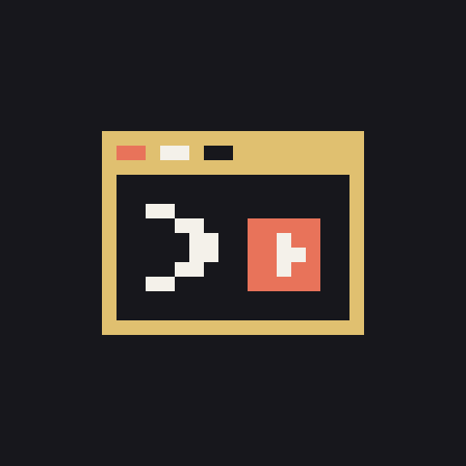

# Arcade — tableaux de tâches, notes, discussions d’équipe et jeux dans Claude Code

[English](README.md) · [Русский](README.ru.md) · [Українська](README.uk.md) · [Español](README.es.md) · **Français** · [Deutsch](README.de.md) · [Português](README.pt.md) · [Italiano](README.it.md) · [Polski](README.pl.md) · [Türkçe](README.tr.md) · [日本語](README.ja.md) · [中文](README.zh.md) · [한국어](README.ko.md)

> **Bêta (0.39).** Tout ce qui est décrit ici fonctionne et sert tous les jours ; désormais, ce sont surtout les détails qui changent. Les signalements de bugs sont les bienvenus — voir [Retours](#retours).

Arcade est un plugin pour [Claude Code](https://claude.com/claude-code) qui en fait un petit espace de travail : des tableaux de projets où Claude traite les cartes une par une, même dans plusieurs sessions à la fois ; un carnet que Claude tient avec vous et que partagent toutes vos sessions ouvertes ; un calendrier ; et des tableaux et discussions partagés pour votre équipe. Et pour l’attente : quand l’agent est occupé depuis plus de 10 secondes, un petit *« envie de jouer ? »* apparaît au-dessus du prompt. Lancez un jeu — NES, Sega, PlayStation, Doom, échecs et plus encore —, lisez un livre, écoutez un livre audio ou un podcast, ou regardez une vidéo sur le sujet du travail de l’agent. Arcade vous prévient dès que l’agent a fini ou a besoin de votre autorisation : vous ne manquez rien.

Tout le catalogue est gratuit : les jeux sont sous licences libres, les livres et livres audio sont dans le domaine public. Vous pouvez aussi jouer en ligne avec d’autres personnes qui attendent leur agent, et discuter avec vos amis.


*Votre tableau : une carte passe à Claude d’un seul bouton, interface en anglais. [Voir la vidéo de 31 secondes](https://github.com/user-attachments/assets/c9076e68-2db6-4f68-9d88-8a132ce96f6a).*


*Pendant que l’agent travaille : 31 secondes dans Claude Desktop, interface en anglais. [Voir la vidéo en 720p](https://github.com/user-attachments/assets/bbb14c28-2813-40c0-82e6-d7375ddc2253).*

## Fonctionnalités

- **Carnet et tableaux de projets.** Des pages, des sous-pages et des checklists que Claude tient aussi, et des tableaux avec des colonnes et des cartes. *Donner à Claude* transmet une page ou une carte à Claude : il coche ce qui est fait et y écrit le résultat. Une page ou une carte affiche son texte mis en forme, avec les boutons *Modifier* et *Copier*. Toutes vos sessions Claude Code ouvertes partagent le carnet, si bien que chacune peut prendre sa propre carte sur le même tableau. Partagez un tableau avec vos amis, et tout le monde travaille sur le même. Envoyez une page vers Notion ou une autre application, ou importez-en une, via les connecteurs de Claude ; dictez dans la zone de saisie de Claude et déplacez le texte sur une page.
- **Claude traite votre tableau.** *File d’attente pour Claude* confie à Claude les cartes de la première colonne une par une : la suivante part dès que la précédente est dans *Fait*, et une question de Claude ou une carte inachevée arrête la file d’attente. Les cartes ont des échéances qui s’affichent dans le calendrier, et sur un tableau partagé chacun voit qui a pris quelle carte. Importez des issues GitHub sur un tableau sous forme de cartes et renvoyez le résultat en commentaire, via le connecteur GitHub de Claude. *Bilan du jour* crée une page pour le stand-up — ce qui est allé à Claude, ce qui est fait, ce qui est en cours — à envoyer dans la discussion de votre équipe.
- **Agents.** *Agents* dans *Travail* montre chaque session Claude Code avec Arcade sur cet ordinateur, par dossier : si elle travaille, attend une autorisation, a terminé son tour ou est libre, et depuis combien de temps, avec sa carte et sa place dans la file d’attente. Quand Claude dans une autre session pose une question à choix, vous y répondez d’un bouton directement dans sa carte. Quand une autre session demande une autorisation ou pose une question, un bandeau dans votre propre panneau vous le signale. La file d’attente d’un tableau peut tourner dans plusieurs sessions à la fois, et deux sessions ne reçoivent pas la même carte.
- **Limites.** La tuile *Limites* dans *Travail* affiche les fenêtres de limite de Claude — 5 heures, la semaine et la limite de dépenses — avec un pourcentage, une barre et l’heure de réinitialisation de chacune, ainsi que le contexte et le coût de cette session et de vos autres sessions. Les chiffres viennent de Claude Code lui-même. Si une limite est épuisée au milieu de la file d’attente d’un tableau, un bouton la reprend après la réinitialisation.
- **Calendrier.** Dans Desktop, un mois de cases de jour de même taille avec un point de la couleur de chaque événement ; dans le terminal et VS Code, la liste de ce qui arrive. Un événement s’ajoute en une ligne, comme « fri 9:30 standup », et peut se répéter tous les jours, en semaine, toutes les semaines, tous les mois ou tous les ans. Choisissez sa couleur et quand être prévenu, dans une liste ou avec vos propres mots (comme « 45 min before » ou « the day before at 20:00 ») ; le rappel arrive en notification système. Les échéances des cartes des tableaux y figurent aussi. Claude ajoute et modifie aussi des événements : « ajoute un appel vendredi à 15:00 ».
- **Amis et discussions.** Une connexion GitHub facultative garde vos paramètres identiques sur tous vos ordinateurs et vous donne un @pseudo ; ajoutez des amis par leur pseudo exact, voyez qui est en ligne, partagez des tableaux, invitez-les à jouer et discutez en tête-à-tête ou en groupe.
- **Sait ce que fait l’agent.** Quand l’agent a fini ou demande une autorisation, un bandeau s’affiche sur le jeu — continuez à jouer, mettez en pause ou retournez directement à l’agent (le comportement se choisit dans les paramètres). Dans Claude Desktop, il peut aussi fermer l’onglet que vous regardez, pour que la conversation soit de nouveau devant vous.
- **Apparaît tout seul.** Après 10 secondes de travail de l’agent, Arcade propose un jeu au-dessus du prompt — ou plus tard, ou jamais, selon vos paramètres ; il ne prend jamais le focus sans que vous le demandiez.
- **Vous suit d’une session à l’autre.** Laissez le panneau Arcade ouvert, et chaque nouvelle session Claude Code l’ouvre d’elle-même ; fermez-le à la main, et il reste fermé.
- **Un menu, six sections.** *Jouer*, *Lire et écouter*, *Regarder*, *Social*, *Travail* et *Plus* — repliez celles dont vous n’avez pas besoin. En haut : *Continuer* la dernière partie, *Rechercher* et *Favoris*. À la première ouverture d’Arcade, vous choisissez les sections à afficher.
- **61 jeux gratuits** sur NES (Dendy), Sega Mega Drive, Master System, PlayStation et un onglet *Jeux* avec des jeux d’arcade, de tir, de course, de stratégie, d’aventure et de société.
- **Lire et écouter.** Des classiques et des livres audio LibriVox en 30 langues, directement depuis Project Gutenberg, Wikisource et LibriVox, ainsi que des articles et des épisodes de podcasts récents sur le sujet du travail de l’agent.
- **Regarder.** Des vidéos YouTube récentes sur le sujet du travail de l’agent, Twitch : vos propres chaînes et des directs sur le code, la tech, la science et le rétrogaming, et TikTok : le fil *Pour toi* et la recherche sur le site même de TikTok, où vous vous connectez vous-même.
- **NES et Flappy Arcade directement dans Claude Code** — dans le terminal, VS Code et Claude Desktop. Tout le reste s’ouvre dans une fenêtre de navigateur ; dans Claude Desktop, par défaut dans le navigateur intégré de Claude (les jeux de tir s’ouvrent quand même dans une fenêtre de navigateur : le navigateur intégré ne peut pas capturer la souris).
- **Jeu en ligne.** Jeux console à deux en réseau, deathmatch et coopération dans Doom, échecs, go, dames et reversi contre des personnes ou contre l’ordinateur.
- **« Qui attend en ligne ».** Arcade indique dans Claude Code quand quelqu’un attend un partenaire, avec un bouton *Rejoindre*.
- **Recherche et favoris.** Une seule recherche dans les jeux et les chaînes Twitch, regroupée par section et par genre ; marquez un jeu d’une ☆ pour le garder dans *★ Favoris*.
- **Vos propres jeux.** Ajoutez les ROM que vous possédez ; elles restent sur votre machine.
- **13 langues d’interface :** English, Русский, Українська, Español, Français, Deutsch, Português, Italiano, Polski, Türkçe, 日本語, 中文, 한국어 — d’après la langue du système ou du navigateur, anglais par défaut.

## Installation

Nécessite **Claude Code 2.1.275 ou plus récent**. *Limites* a besoin d’un Claude Code qui transmet les limites aux plugins (vérifié sur 2.1.302 et 2.1.316) ; sur une version plus ancienne, cet écran l’indique et le reste d’Arcade fonctionne comme d’habitude.

Dans un terminal, deux commandes : ajoutez la marketplace d’Arcade (ce dépôt), puis installez le plugin depuis celle-ci :

```
claude plugin marketplace add ArbakovMaxim/agent-arcade
claude plugin install arcade@agent-arcade
```

Ou dans une session Claude Code :

```
/plugin marketplace add ArbakovMaxim/agent-arcade
/plugin install arcade@agent-arcade
```

Le plugin est installé pour toutes les sessions et applications. L’extension VS Code n’a pas de commande `/plugin` : installez-le depuis un terminal, et l’extension le prendra en compte dans une nouvelle conversation.

**Mise à jour :**

```
/plugin marketplace update agent-arcade
/plugin update arcade@agent-arcade
```

Redémarrez ensuite Claude Code. La marketplace ne télécharge que le plugin — quelques Mio, sans le site —, donc une mise à jour prend quelques secondes. Si Arcade est déjà installé, vous n’avez rien à faire : la marketplace bascule d’elle-même à la prochaine mise à jour.

Si `/plugin update` affiche *already at the latest version* alors qu’une nouvelle version d’Arcade est sortie, la marketplace ne s’est pas actualisée. Pour savoir pourquoi, lancez `claude plugin marketplace update agent-arcade` dans un terminal. S’il indique *timed out*, laissez 10 minutes au clonage :

```
CLAUDE_CODE_PLUGIN_GIT_TIMEOUT_MS=600000 claude plugin marketplace update agent-arcade
```

Dans PowerShell : `$env:CLAUDE_CODE_PLUGIN_GIT_TIMEOUT_MS=600000; claude plugin marketplace update agent-arcade`. Relancez ensuite `/plugin update arcade@agent-arcade`.

**Désinstallation :** `/plugin uninstall arcade@agent-arcade`

## Utilisation

- **`/arcade`** ouvre le menu à tout moment.
- Laissez le panneau ouvert, et les nouvelles sessions l’ouvrent d’elles-mêmes : dans le terminal au démarrage, dans Desktop et VS Code quand elles se connectent à la session ; le clavier reste sur le prompt. Fermez-le à la main (la croix ou Esc), et il cesse de s’ouvrir tout seul jusqu’à ce que vous le rouvriez.
- Quand l’agent travaille plus de 10 secondes, *« envie de jouer ? »* apparaît au-dessus du prompt : **`1`** — jouer ici, dans le panneau ; **`2`** — dans une fenêtre de navigateur (si disponible) ; **`3`** — pas maintenant. Dans Paramètres → Notifications, vous choisissez quand cette ligne apparaît — de 10 secondes à 5 minutes — ou vous la désactivez.
- Flèches ou Tab pour choisir, Entrée pour ouvrir ; la souris fonctionne aussi. Les commandes sont indiquées sous chaque jeu.
- Quand l’agent a fini ou attend une autorisation, un bandeau s’affiche sur le jeu : **Retour à l’agent** ou **Continuer à jouer**.

### Le menu

| Section | Contenu |
|---|---|
| *(en haut)* | **▶ Continuer** la dernière partie, **🔍 Rechercher**, **★ Favoris** |
| **Jouer** | NES, Sega, Master System, PlayStation, Jeux ; *Rejoindre* quand quelqu’un attend en ligne ; **Mes jeux** |
| **Lire et écouter** | Livres, Livres audio, Articles, Podcasts |
| **Regarder** | YouTube, Twitch, TikTok |
| **Social** | Amis, Discussions, **Se connecter avec GitHub** (ou **Compte** une fois connecté) |
| **Travail** | Carnet, Tableau de projets, Calendrier, Agents, Limites |
| **Plus** | Fenêtre Arcade, Paramètres, 🌐 langue, 🐞 Signaler un bug, ☕ Soutenir le projet |

Cliquez sur le titre d’une section pour la replier ou la déplier. Une section repliée affiche `▸` et le nombre de tuiles qu’elle contient, et *Social* affiche aussi les nouveaux messages 💬 et les demandes d’ami 👥. Arcade se souvient des sections repliées. Une section dont vous n’avez pas besoin peut être masquée dans les **Paramètres** : elle disparaît complètement du menu, titre et tuiles compris ; *Plus*, qui contient les paramètres, reste toujours. Une fois connecté, l’en-tête du menu affiche votre @pseudo avec les mêmes compteurs.

La **recherche** démarre dès deux lettres et trouve un titre ou un genre, sans tenir compte de la casse ni des accents. Les résultats sont regroupés par section et par genre, par exemple *Jeux · Jeux de tir*. L’étoile ☆ à côté d’un jeu l’ajoute aux **★ Favoris** (jusqu’à 100), classés par section et par genre, les plus récents en premier. Les livres et les livres audio ont leur propre recherche, par titre ou par auteur.

### Où s’ouvre quoi

| | NES (Dendy), Flappy Arcade | Sega, Master System, PlayStation, autres Jeux ; livres, livres audio, articles, podcasts, vidéos |
|---|---|---|
| **Terminal** | dans le panneau (graphismes en pixels si le terminal les prend en charge, sinon blocs de texte) | fenêtre de navigateur |
| **VS Code** | dans le panneau | fenêtre de navigateur |
| **Claude Desktop** | dans le panneau | navigateur intégré de Claude ou fenêtre de navigateur (au choix dans les paramètres) ; jeux de tir — toujours une fenêtre de navigateur |

La fenêtre de navigateur est une fenêtre Arcade séparée (votre navigateur par défaut ou celui choisi dans les paramètres), pas un onglet parmi vos onglets habituels. Les discussions fonctionnent directement dans le panneau, dans le terminal et dans Desktop ; *Ouvrir dans une page* les ouvre de la même façon sur le site. Le carnet, les tableaux de projets, le calendrier et les agents vivent dans le panneau. TikTok s’ouvre dans le navigateur intégré de Claude dans Desktop, et ailleurs dans votre navigateur par défaut, où vous êtes probablement déjà connecté.

## Carnet et tableaux de projets

Les deux se trouvent dans la section *Travail* du menu.

- **Carnet.** Des pages et des sous-pages ; une ligne qui commence par `# ` est un titre, par `- ` un élément, par `- [ ] ` un élément de checklist qui se coche d’un clic. Il est conservé sur cet ordinateur — jusqu’à 200 pages, 20 000 caractères par page.
- **Modifier et Copier.** Une page ou une carte affiche son texte mis en forme — titres, listes, checklist — dans Desktop et VS Code, et sous forme de lignes dans le terminal. *Modifier* ouvre la zone de texte à sa place : Entrée enregistre, *Annuler* abandonne la modification, et ce que Claude ou une autre session change entre-temps apparaît dans la zone. *Copier* place toute la page dans le presse-papiers — dans le panneau de Desktop, on ne peut sélectionner du texte que dans les champs de saisie, c’est donc ainsi qu’on copie une page.
- **Claude le tient aussi.** *Donner à Claude* transmet une page à Claude, ou demandez simplement à Claude de noter quelque chose dans Arcade. Claude utilise l’outil `mcp__arcade__notes`, qui ne modifie que le carnet et ne supprime rien. Si la modification de Claude ne vous plaît pas : *Rétablir le texte d’avant la modification de Claude*.
- **Notion et autres applications** — via les connecteurs de Claude, donc Arcade n’a besoin d’aucune clé ni d’aucun mot de passe : *Envoyer vers Notion*, *Vers une autre application*, *Importer depuis Notion ou une autre application*. Une page liée peut être mise à jour dans l’application ou réimportée depuis celle-ci.
- **À la voix.** Dictez dans la zone de saisie de Claude avec la dictée du système (Win+H sous Windows, deux fois Fn sous macOS), puis appuyez sur *Prendre dans la zone de saisie de Claude* — le texte passe à la fin de la page.
- **Tableau de projets.** Des colonnes — *À faire*, *En cours*, *Fait* ou les vôtres, jusqu’à 8 — et des cartes ; une carte est une page du carnet avec du texte et une checklist. Appuyez sur une carte pour la choisir et la déplacer avec les flèches, appuyez encore pour l’ouvrir. Claude peut aussi gérer un tableau : *Donner à Claude*, ou demandez-lui de répartir des tâches sur un tableau dans Arcade.
- **Tableaux partagés.** Une fois connecté avec un @pseudo, cochez des amis et appuyez sur *Partager* : tout le monde a les mêmes cartes, colonnes et nom, et les modifications arrivent en quelques secondes. Le propriétaire invite d’autres amis, retire des participants et supprime le tableau du site ; chacun peut le quitter ; quoi qu’il arrive, chacun garde sa propre copie. Jusqu’à 3 tableaux partagés dont vous êtes propriétaire, 20 personnes et 200 cartes par tableau.
- **Plusieurs sessions à la fois.** Toutes les sessions Claude Code ouvertes sur cet ordinateur partagent un même carnet et ses tableaux : ce qu’une session ajoute, modifie ou coche, les autres le voient en quelques secondes, et chaque session peut ainsi suivre sa propre carte du même tableau.
- **File d’attente pour Claude.** Sur un tableau, *File d’attente pour Claude* donne à Claude la première carte de la première colonne et la déplace dans la deuxième colonne si le tableau en a plus de deux. Quand Claude termine son tour avec cette carte dans la dernière colonne, la carte suivante part d’elle-même, jusqu’à 10 cartes par passage. La file d’attente s’arrête quand Claude pose une question, que son tour est interrompu ou se termine par une erreur, que la carte n’est pas dans la dernière colonne, ou que vous envoyez autre chose à Claude — à partir de là, c’est vous qui décidez. Une demande d’autorisation ne l’arrête pas : si elle est accordée — par vous ou par le mode automatique — et que la carte est dans la dernière colonne, la suivante part. *Arrêter la file d’attente* laisse Claude terminer la carte en cours sans lui donner la suivante. Sur un tableau partagé, les cartes prises par quelqu’un d’autre sont sautées. Une file d’attente peut tourner dans plusieurs sessions à la fois — voir [Agents](#agents). Si la limite de Claude est épuisée au milieu d’une file d’attente, celle-ci peut reprendre après la réinitialisation — voir [Limites](#limites).
- **Échéances.** Le champ *Échéance* d’une carte accepte « fri », « tomorrow », « 20.11 » ou « 2026-11-20 ». La date s’affiche sous la carte sur le tableau — dans une couleur d’alerte une fois passée si la carte n’est pas terminée — et dans le calendrier, qui vous la rappelle à 9:00 ce jour-là, sauf si la carte est déjà dans la dernière colonne. Claude fixe aussi des échéances.
- **Qui a pris une carte.** Sur un tableau partagé, *Donner à Claude* marque la carte comme la vôtre, et tout le monde voit « prise par @pseudo » en dessous. Si quelqu’un d’autre l’a prise, Arcade vous le dit d’abord ; appuyez encore pour la donner quand même à votre Claude. *Libérer la carte* la rend de nouveau libre.
- **Issues GitHub.** *Issues de GitHub* sur un tableau accepte `owner/repo` ou un lien vers des issues : Claude lit jusqu’à 20 issues ouvertes via son connecteur GitHub et ajoute en cartes celles qui ne sont pas encore sur le tableau. Sur une telle carte, *Résultat vers GitHub* demande à Claude de publier sur l’issue un court commentaire sur ce qui a été fait ; il ne ferme pas l’issue. Arcade lui-même ne communique jamais avec GitHub et n’a besoin d’aucune clé.
- **Bilan du jour.** Le bouton sous les tableaux et dans le carnet crée une page « Bilan JJ.MM » : ce qui est allé à Claude aujourd’hui, ce qui est fait — cartes passées dans la dernière colonne, points cochés — et ce qui est encore en cours. Donnez-la à Claude, modifiez-la ou envoyez-la dans une discussion.
- **Envoyer dans une discussion.** Une fois connecté, *Envoyer dans une discussion* publie n’importe quelle page en texte dans l’une de vos discussions récentes, en gardant les titres et les cases de la checklist.

## Calendrier

Il se trouve dans la section *Travail* du menu. Comme le carnet, le calendrier est gardé sur cet ordinateur, dans le stockage des plugins de Claude Code, et toutes vos sessions ouvertes le partagent.

- **Mois et jour.** Dans Desktop, une grille du mois faite de cases de jour de même taille, avec des flèches et *Aujourd’hui* : en haut la date, en dessous un point de la couleur de chaque événement (jusqu’à trois, puis « +N »). Le jour choisi a un cadre mis en évidence, aujourd’hui un fond teinté. Sous la grille, les événements du jour choisi, puis *À venir* pour les 30 prochains jours, en cartes de la couleur de chaque événement. Dans le terminal et VS Code, c’est la liste *À venir*.
- **Une ligne ajoute un événement :** « fri 9:30 standup », « tomorrow 15:00 call », « 12.11 review », « 2026-11-20 10:00 demo ». Sans jour, c’est le jour choisi dans la grille (dans le terminal, aujourd’hui) ; sans heure, toute la journée. Les mots pour les jours sont compris en anglais et en russe.
- **Répétition.** Ne se répète pas, tous les jours, en semaine, toutes les semaines, tous les mois ou tous les ans ; le jour de l’événement est celui où la série commence. Une ligne peut aussi l’indiquer : « every friday 10:00 retro », « on weekdays 9:30 standup ».
- **Couleur.** Bleu, vert, jaune, orange, rouge, violet, rose ou gris ; bleu par défaut.
- **Rappel.** Choisissez-le dans une liste : au début, 5, 10, 15 ou 30 minutes, 1 ou 2 heures, un jour, deux jours ou une semaine avant ; pour un événement d’une journée entière, à 9:00, 8:00 ou 7:00 ce jour-là, la veille à 21:00, 18:00 ou 9:00, deux jours ou une semaine avant à 9:00. Ou écrivez votre propre moment, en anglais ou en russe : « 45 min before », « at 14:30 », « the day before at 20:00 » — pas après le début, ni plus d’une semaine avant. Dans l’app Claude sur téléphone, qui n’a pas de liste, un bouton fait défiler les choix.
- **Notifications.** Un rappel arrive en notification système et en bref bandeau tant qu’une session de Claude Code est ouverte ; une seule session l’affiche, pas toutes. Un rappel manqué pendant que Claude Code était fermé s’affiche au démarrage suivant comme *Manqué*, si l’événement date de moins d’un jour.
- **Claude le tient aussi**, avec l’outil `mcp__arcade__calendar`, qui ne modifie que le calendrier : « ajoute un appel vendredi à 15:00 », « qu’est-ce que j’ai demain ? », « mets la démo en rouge ».
- **Échéances des cartes.** Les cartes de tableau avec une échéance s’affichent le jour dit en entrées d’une journée entière, *fait* une fois la carte dans la dernière colonne ; vous les modifiez sur la carte.
- Il ne se synchronise pas encore avec les calendriers Google ou Apple.

## Agents

C’est dans la section *Travail* du menu : les sessions Claude Code avec Arcade sur cet ordinateur, chacune désignée par son dossier, la vôtre marquée *cette session*.

- **Ce que fait chacune.** *Attend une autorisation*, *en attente de réponse*, *a terminé son tour*, *travaille* ou *libre*, et depuis combien de temps, avec la carte en cours et sa place dans la file d’attente, par exemple *File d’attente : carte 3 sur 10*. Les sessions en attente d’autorisation viennent en premier. Dans Desktop, chaque session est une carte ; dans le terminal et VS Code, une ligne. Une session fermée disparaît en moins d’une minute.
- **Retrouvez-la par son dossier.** Arcade ne peut pas ouvrir une autre session à votre place ; le nom du dossier vous indique de quelle fenêtre ou de quel onglet il s’agit.
- **Répondez d’ici.** Quand Claude dans une autre session pose une question à choix, sa carte affiche la question et les choix sous forme de boutons. Une question seule part au premier appui ; s’il y en a plusieurs, choisissez les options et appuyez sur *Répondre*. En une seconde, Claude dans cette session reçoit la réponse comme si vous l’aviez donnée là-bas. Une demande d’autorisation s’affiche aussi, avec l’outil et la commande, par exemple *Bash: npm test*, mais l’autorisation ne se donne que dans cette session elle-même.
- **Une file d’attente, plusieurs sessions.** Appuyez sur *File d’attente pour Claude* sur le même tableau dans chaque session, et celle qui est libre prend la carte suivante ; deux sessions ne reçoivent pas la même carte. Une session qui rejoint la file le signale : *Une file d’attente tourne déjà sur ce tableau dans la session « api »*. Chaque session arrête sa propre file d’attente selon les mêmes règles — une question de Claude, une carte inachevée, un tour interrompu, un autre message à Claude — et donne à Claude jusqu’à 10 cartes par passage. *Arrêter la file d’attente* n’arrête que cette session ; *Arrêter partout* les arrête toutes, et chacune termine sa carte en cours. Sous une carte, le tableau indique qui l’a : *dans la session « api »*.
- **Même dossier.** Si une session déjà dans la file d’attente travaille dans le même dossier, Arcade prévient que les deux peuvent modifier les mêmes fichiers, et cette session ne rejoint la file que si vous appuyez à nouveau sur *File d’attente pour Claude*. Un dossier séparé ou un git worktree est plus sûr.
- **Bandeaux.** Quand une autre session demande une autorisation ou pose une question, un bandeau dans votre propre panneau Arcade affiche *La session « api » attend une autorisation* ou *…attend une réponse à une question* — sans son ni notification système. Désactivez-le, ou activez un bandeau pour un tour terminé (désactivé par défaut), dans *Paramètres → Notifications*.
- **En masquer une.** La × à côté d’une autre session la masque, avec ses bandeaux, jusqu’à ce que vous la réaffichiez depuis *Sessions masquées*, en bas ; une session masquée qui attend une autorisation ou une réponse l’indique là. Les sessions masquées sont mémorisées dans toutes les sessions.
- **Reste sur cet ordinateur.** Chaque session garde un petit fichier dans `~/.claude/arcade/agents` avec son dossier, son état et sa carte, la question ou la demande d’autorisation qu’elle attend, ainsi que son contexte, son coût et ses fenêtres de limite pour [Limites](#limites) ; une réponse depuis *Agents* arrive à la session sous forme d’un petit fichier à côté. Rien ne part vers le site d’Arcade.

## Limites

C’est dans la section *Travail* du menu. Les chiffres viennent de Claude Code lui-même, les mêmes que ceux de la ligne d’état : Arcade ne compte rien de son côté.

- **Fenêtres de limite.** 5 heures, la semaine et la limite de dépenses — un pourcentage, une barre et l’heure de réinitialisation : *réinitialisation à 14:30 (dans 1 h 20 min)*. La barre est bleue, jaune à partir de 80 % et rouge une fois la limite épuisée. Les fenêtres de limite appartiennent au compte et sont partagées par toutes ses sessions : l’écran affiche donc la mesure la plus récente parmi toutes les sessions de cet ordinateur, et depuis combien de minutes elle date.
- **Quand il n’y a pas de fenêtres.** Avant la première réponse de Claude, l’écran l’indique : *Apparaîtra après la première réponse de Claude.* Avec une clé API ou via une passerelle, il n’y a aucune fenêtre — seulement le contexte et le coût : les fenêtres de 5 heures et hebdomadaire viennent avec les abonnements Claude (Pro, Max, Team, Enterprise).
- **Cette session et les autres.** Le remplissage du contexte, en pourcentage et en tokens, et le coût depuis le début de la session ; en dessous, le contexte et le coût des autres sessions de cet ordinateur. Les mêmes chiffres apparaissent dans leurs cartes dans [Agents](#agents).
- **La file d’attente après une réinitialisation.** Si le tour de Claude s’interrompt au milieu de la [file d’attente d’un tableau](#carnet-et-tableaux-de-projets) et que Claude Code affiche une fenêtre à 100 %, la file d’attente s’arrête et indique quand la limite sera réinitialisée. *Reprendre la file d’attente après la réinitialisation à 14:31* la reprend à partir de la même carte une minute après la réinitialisation ; pendant l’attente s’affichent *La file d’attente « Lancement » reprendra à 14:31.* et *Ne pas reprendre*. Vous pouvez marquer un tableau à l’avance : sa file d’attente reprend alors d’elle-même, sans bouton.
- **Seulement quand Claude Code est ouvert.** Seule une session ouverte, sur un ordinateur qui ne dort pas, peut reprendre la file d’attente. Si Claude Code était fermé ou que l’ordinateur dormait, *Limites* l’indique : *La file d’attente « Lancement » n’a pas repris après la réinitialisation de la limite : Claude Code était fermé ou l’ordinateur dormait.* ; si la session qui attendait a été fermée : *…n’a pas démarré après la réinitialisation de la limite : la session était fermée.* La × efface la note.
- **Un bandeau à 80 et 90 %.** Quand une fenêtre atteint 80 %, puis 90 %, un bandeau s’affiche dans le panneau Arcade — une fois par seuil pour toutes les sessions. Désactivez-le dans *Paramètres → Notifications*.
- **Quel Claude Code.** Toutes les versions de Claude Code ne transmettent pas les limites aux plugins — vérifié sur 2.1.302 et 2.1.316. Si la vôtre ne le fait pas, l’écran l’indique et le reste d’Arcade fonctionne comme d’habitude.

## Pour les équipes

Une petite équipe peut tenir ses tâches dans Arcade : un tableau partagé, et celui qui prend une carte la confie à son propre Claude.

1. Tout le monde installe Arcade (Claude Code 2.1.275 ou plus récent) — voir [Installation](#installation).
2. `/arcade` → **Social** → **Se connecter avec GitHub** : la page de GitHub s’ouvre dans votre navigateur ; confirmez-y, puis cliquez sur *Sign in* sur la page d’Arcade (son code doit être le même que dans le panneau). Si cela ne marche pas : *Se connecter avec un code*.
3. Prenez un @pseudo — votre nom GitHub en un clic, ou le vôtre.
4. Ajoutez-vous les uns les autres en amis par @pseudo exact ; l’autre personne accepte.
5. **Travail** → créez un tableau → cochez vos coéquipiers → **Partager**.
6. Vous n’êtes là que pour les tableaux et les discussions ? À la première ouverture d’Arcade, ne gardez que **Travail** et **Social**. Puis, dans **Paramètres → Notifications**, appuyez sur **Ligne « envie de jouer ? »** jusqu’à ce qu’elle indique *désactivée* : plus rien n’apparaîtra au-dessus du prompt pendant que l’agent travaille.

Ensuite : ouvrez le tableau, choisissez une carte, **Donner à Claude**. Si Claude est libre, la carte lui parvient aussitôt ; s’il est occupé, elle attend dans la zone de saisie jusqu’à ce que vous l’envoyiez. Claude coche ce qui est fait et écrit le résultat sur la carte, et tous ceux qui sont sur le tableau le voient en quelques secondes — ainsi que qui a pris quelle carte. Donnez une échéance à chaque carte, et elle s’affiche dans votre calendrier. En fin de journée, *Bilan du jour* → *Envoyer dans une discussion* met votre stand-up dans la discussion de l’équipe. Les discussions sont dans **Social**.

Vous faites tourner vous-même plusieurs sessions Claude Code ? Appuyez sur *File d’attente pour Claude* sur le même tableau dans chacune : une session libre prend la carte suivante, et **Travail** → **Agents** montre ce que fait chaque session.

Bon à savoir : les tableaux partagés et les discussions sont stockés sur le site d’Arcade et ne sont pas chiffrés, n’y mettez donc ni mots de passe ni clés. Arcade ne connaît que le nom et l’image de votre profil GitHub. Jusqu’à 3 tableaux partagés dont vous êtes propriétaire, 20 personnes et 200 cartes par tableau. *Supprimer le compte* (appuyez deux fois) fait oublier au site votre compte et vos paramètres.

## Compte, amis et discussions

La connexion est facultative : sans elle, tout le reste fonctionne comme avant.

- **Se connecter avec GitHub** (dans *Social*) : la page de connexion de GitHub s’ouvre dans votre navigateur habituel ; confirmez-y, puis cliquez sur *Sign in* sur la page d’Arcade — son code doit être le même que dans le panneau. Si la connexion par le navigateur ne marche pas, choisissez *Se connecter avec un code* : Arcade affiche un code que vous saisissez sur la page de GitHub. Arcade ne connaît que le nom et l’image de votre profil GitHub — pas d’e-mail, aucun accès aux dépôts.
- **Synchronisation.** Votre langue, vos touches, vos notifications, la taille du panneau, ce qu’il faut faire du jeu quand l’agent signale, les options du navigateur dans Desktop, vos sujets, vos chaînes Twitch, vos favoris, les sections repliées et masquées, et votre record à Flappy Arcade deviennent identiques sur tous vos ordinateurs. Vos propres jeux, le navigateur et le mode graphique restent propres à chaque ordinateur.
- **@pseudo.** Reprenez votre nom GitHub en un clic ou inventez-en un : de 4 à 32 caractères — lettres latines, chiffres et `_`. Vous pouvez le changer jusqu’à 5 fois par jour.
- **Amis.** Ajoutez un ami par son @pseudo exact : il accepte la demande de son côté, et vous apparaissez dans vos listes respectives. Il n’y a pas de suggestions pendant la saisie, donc personne ne peut parcourir qui utilise Arcade. Refuser et supprimer se font en silence.
- **En ligne et invitations à jouer.** Tant que le menu d’Arcade est ouvert, vos amis vous voient *en ligne*, et vous les voyez ; pour rester invisible, désactivez *Montrer à mes amis que je suis en ligne* sur l’écran *Amis*. *Inviter* à côté d’un ami propose les jeux en réseau : un jeu de société ouvre une salle rien que pour vous deux, un jeu Doom son lobby. Le jeu s’ouvre aussitôt chez vous ; votre ami reçoit une notification et *Accepter* en haut du menu, et l’invitation est valable 10 minutes. On peut inviter là où les jeux en réseau s’ouvrent dans un navigateur : celui intégré à Desktop ou une fenêtre du navigateur.
- **Discussions.** En tête-à-tête avec un ami, en groupe d’amis, ou un groupe avec tous vos amis en un clic. Écrivez directement dans le panneau Arcade ou ouvrez la page des discussions sur le site. Vous pouvez modifier ou supprimer vos propres messages depuis le menu ⋮ à côté ; sur le site, un clic droit ouvre le même menu. Les messages sont stockés sur le site d’Arcade et ne sont pas chiffrés — n’y écrivez ni mots de passe ni clés.
- **Avatars et notifications de messages.** Choisissez l’un des 24 avatars prêts à l’emploi dans *Compte* — les discussions ne font que l’afficher ; sans avatar, c’est la première lettre de votre @pseudo. L’image d’un groupe est choisie par son propriétaire parmi les mêmes 24. Votre image GitHub n’est jamais montrée aux autres. Quand un ami vous écrit, une carte apparaît en bas à gauche au-dessus de toutes les fenêtres (Windows) ou une notification système (macOS, Linux) ; un clic sur la carte ouvre cette discussion.
- **Se déconnecter** arrête la synchronisation sur cet ordinateur ; **Supprimer le compte** (appuyez deux fois) fait oublier au site votre compte et vos paramètres.

## Le catalogue

| Onglet | Contenu |
|---|---|
| **NES (Dendy)** | 28 jeux homebrew — plateformes, puzzles, tir, course : Thwaite, Nova the Squirrel, Super Uwol, Lala the Magical et d’autres |
| **Sega** | 11 jeux Mega Drive : Miniplanets, Tank Battle, Battle 4Tris, Pong et d’autres |
| **Master System** | 4 jeux : Balloon Master, SkyHaul, Food Fighter, Escape from Monster Dimension |
| **PlayStation** | Hello Pong |
| **Jeux → Jeux d’arcade** | Flappy Arcade — le jeu à un bouton d’Arcade : se joue directement dans le panneau et dans la fenêtre Arcade ; le parcours du jour est le même pour tout le monde, votre meilleur score est conservé |
| **Jeux → Jeux de tir** | Freedoom Phase 1 et 2 (remplaçants libres de Doom), le deathmatch FreeDM, Blasphemer (remplaçant libre de Heretic), le deathmatch BlasphDM, OpenArena — jeu de tir en arène sur le moteur de Quake III contre des bots (GPL-2.0) |
| **Jeux → Jeux de course** | HexGL — course futuriste antigravité |
| **Jeux → Stratégie** | OpenTTD — magnat du transport (GPL-2.0) ; Micropolis — le code ouvert du célèbre jeu de construction de ville de 1989, votre ville est enregistrée dans le navigateur (micropolisJS, GPL-3.0 avec conditions supplémentaires et la Micropolis Public Name License) ; Warzone 2100 — stratégie en temps réel avec campagne et escarmouche contre l’ordinateur, vous concevez vos propres unités, les sauvegardes restent dans le navigateur (GPL-2.0-or-later) |
| **Jeux → Aventures** | Quatre aventures classiques gratuites des années 90 dans ScummVM (GPL-3.0-or-later) : Beneath a Steel Sky, Flight of the Amazon Queen, Lure of the Temptress et Nippon Safes, Inc. — données de jeu freeware redistribuables avec autorisation ; sauvegarde à tout moment avec F5 |
| **Jeux → Jeux de société** | Échecs — contre des personnes ou l’ordinateur (Stockfish, niveaux 1 à 10), en ligne avec pendule ; go sur plateaux 9×9, 13×13 et 19×19 ; dames russes, reversi ; *Abandonner* dans tous |
| **Livres** | Des classiques du domaine public en 30 langues — c’est vous qui choisissez la langue (au départ, celle de l’interface). Les sections sont les mêmes dans toutes les langues : Populaires, Romans, Poésie, Théâtre, Aventure, Policiers et d’autres ; la recherche se fait par titre ou par auteur. La liste arrive à la demande depuis Project Gutenberg et Wikisource — Arcade ne stocke aucun livre ; un livre ouvert reste dans *Mes livres* de votre navigateur. Le marque-page se place tout seul : rouvrez un livre et vous reprenez là où vous vous étiez arrêté. Vos propres EPUB, FB2 et TXT s’ouvrent aussi dans la fenêtre Arcade |
| **Livres audio** | Des enregistrements LibriVox dans les mêmes langues et les mêmes sections, avec recherche : écoutez en ligne directement depuis archive.org, ou téléchargez un livre dans votre navigateur pour l’écouter hors ligne. Le lecteur de la fenêtre Arcade retient le chapitre, la position et la vitesse ; vos fichiers MP3, M4A, M4B, OGG et Opus s’y ouvrent aussi et restent dans votre navigateur |
| **Articles** | Articles récents de 106 blogs et publications anglophones sélectionnés — Simon Willison, InfoQ, The Cloudflare Blog, Ars Technica, Krebs on Security et d’autres |
| **Podcasts** | Épisodes récents de 65 podcasts anglophones — Software Engineering Daily, Security Now, Talk Python To Me, Darknet Diaries et d’autres ; chaque épisode retient où vous vous êtes arrêté |
| **YouTube** | Vidéos récentes de 153 chaînes sélectionnées dans 24 domaines, de l’IA, du web et du DevOps à la science, à l’espace et au rétro-informatique |
| **Twitch** | *Mes chaînes* — n’importe quelle chaîne Twitch par nom ou lien, celles en direct d’abord ; *En direct maintenant* et *Catalogue complet* — 26 chaînes anglophones sélectionnées, sans chaînes 18+ ; aucune inscription nécessaire |

La fiche de chaque jeu renvoie à sa licence et à son code source.

**Sujets.** Articles, Podcasts et YouTube commencent par des sujets : Haiku en propose trois sur ce sur quoi travaille l’agent, plus *Nouveautés et présentations*. Dans *Votre sujet*, vous pouvez écrire ce que vous voulez regarder, lire ou écouter, dans n’importe quelle langue ; vos cinq derniers sujets restent en tuiles dans *Mes sujets*.

## Jeu en ligne

- **Consoles.** Les jeux à deux sur NES, Sega, Master System et PlayStation ont un bouton **En ligne** : créez une salle ou rejoignez celle de quelqu’un. Les commandes sont synchronisées image par image via le serveur d’Arcade.
- **Doom.** **FreeDM** et **BlasphDM** sont des salons de deathmatch avec des manches de 5 minutes, jusqu’à quatre joueurs ; **Freedoom** et **Blasphemer** proposent la coopération via **En ligne**. Les nouveaux venus attendent la manche suivante : le moteur ne permet pas de rejoindre une partie en cours.
- **Jeux de société.** *Trouver un adversaire*, *Inviter un ami* par lien, ou *Contre l’ordinateur*. La partie est enregistrée sur le serveur : jouez un coup, retournez à votre agent, rouvrez le lien plus tard — le plateau est là où vous l’avez laissé. Connecté avec un @pseudo, votre adversaire le voit à côté de votre couleur.
- **Qui attend.** Une fois par minute, Arcade vérifie si quelqu’un attend un partenaire et l’affiche dans Claude Code — par exemple *« envie de jouer ? En attente en ligne : FreeDM (1) »* — avec un bouton **Rejoindre** dans le menu.

## Vos propres jeux

- **`/arcade-add <fichier>`** ajoute une ROM NES, Mega Drive ou Master System (jusqu’à 4 Mo). Le plugin en garde une copie dans `~/.claude/arcade` et ne l’envoie jamais nulle part.
- **Disques PlayStation et WAD de Doom** (par exemple un `doom.wad` que vous possédez) — dans la fenêtre Arcade : **Ouvrir votre propre fichier**. Ils restent uniquement dans ce navigateur.

N’ajoutez que des fichiers sur lesquels vous avez des droits.

## Paramètres

Ouvrez **Paramètres** dans la section *Plus* du menu `/arcade` :

- **Sections du menu principal** — afficher ou masquer n’importe quelle section sauf *Plus* ; une section masquée disparaît complètement du menu jusqu’à ce que vous la rétablissiez ici. Le même choix est proposé à la première ouverture d’Arcade.
- **Langue** — l’une des 13 (aussi directement dans le menu : 🌐).
- **Ouvrir les jeux** — ici dans le panneau, dans une fenêtre de navigateur ou dans un navigateur précis ; dans Claude Desktop — dans le navigateur intégré de Claude ou dans une fenêtre de navigateur.
- **Graphismes** (terminal) — pixels dans les terminaux qui affichent des images (kitty, Ghostty, Rio), blocs de texte partout ailleurs.
- **Taille du panneau** — normale ou pleine largeur.
- **Quand l’agent termine** — bandeau et continuer à jouer, pause avec bandeau, ou retour direct à l’agent.
- **Quand l’agent demande une autorisation** — les trois mêmes options.
- **À l’ouverture du navigateur** (Claude Desktop) — fermer le menu Arcade pour que le navigateur ait toute la hauteur, ou garder le menu au-dessus.
- **L’agent a terminé pendant que vous regardez** (Claude Desktop) — fermer l’onglet qu’Arcade a ouvert pour une vidéo, un direct, TikTok, un article ou un épisode, pour que la discussion avec Claude soit de nouveau devant vous, ou seulement vous prévenir.
- **Notifications pendant le jeu dans une fenêtre.**
- **Notifications de messages** — une carte en bas à gauche quand un ami écrit dans une discussion (une notification système sous macOS et Linux).
- **Une autre session attend une autorisation** et **Une autre session a terminé son tour** — un bandeau dans le panneau Arcade à propos des autres sessions de cet ordinateur, sans son (voir [Agents](#agents)) ; le premier couvre aussi une question et est activé par défaut, le second non.
- **Limite de Claude à 80 et 90 %** — un bandeau dans le panneau Arcade quand une fenêtre de limite atteint 80 % et 90 % (voir [Limites](#limites)) ; activé par défaut.
- **Test des touches et réattribution des touches** (terminal).
- **Conditions et confidentialité** — les Conditions d’utilisation et la Politique de confidentialité du site, dans votre navigateur habituel.

## Ce que le plugin fait sur votre ordinateur

Arcade tourne dans Claude Code avec l’accès que Claude Code donne aux plugins. Tout son code est dans ce dépôt, et `claude plugin validate ./mod` liste chaque événement auquel il s’accroche et chaque appel qu’il fait. En bref :

- **Les outils de l’agent.** Arcade voit quand un outil démarre et se termine et quand l’agent demande une autorisation — c’est ainsi qu’il sait quand afficher son bandeau. Il ne modifie ni ne bloque jamais les appels d’outils de l’agent. Il n’autorise lui-même que trois sortes d’appels, et seulement là où Claude Code vous poserait sinon la question : `mcp__arcade__notes`, qui ne modifie que le carnet et ne supprime rien ; `mcp__arcade__calendar`, qui ne modifie que le calendrier ; et l’ouverture d’un jeu dans le navigateur intégré de Desktop après que vous l’avez choisi dans le panneau. Vos règles d’autorisation et de refus s’appliquent telles quelles.
- **Interrompre l’agent.** Uniquement dans Claude Desktop, quand vous ouvrez quelque chose dans le navigateur intégré pendant que l’agent travaille : Desktop ne laisse pas un plugin ouvrir le navigateur lui-même. Arcade attend la fin de l’outil en cours (il le coupe au bout de 10 secondes, mais attend tant qu’une demande d’autorisation est affichée), interrompt l’agent et demande à Claude d’ouvrir la page et de reprendre son travail. Pour éviter cela, choisissez une fenêtre de navigateur dans *Paramètres → Ouvrir les jeux*.
- **Votre conversation.** Pour les sujets, Haiku reçoit dans votre propre session la fin de la conversation, quelques milliers de caractères ; cela compte dans votre utilisation de Claude. Le site d’Arcade ne voit jamais la conversation. Arcade n’écrit dans la zone de saisie ou ne l’envoie que lorsque vous le demandez — par exemple *Donner à Claude* dans le carnet, ou la carte suivante d’une *File d’attente pour Claude* que vous avez lancée — ou pour ouvrir une page comme décrit ci-dessus.
- **Limites.** Après chaque tour et toutes les trente secondes, Arcade demande à Claude Code sa propre mesure des limites, du contexte et du coût — ce qu’affiche la ligne d’état. Cela ne coûte rien et ne compte pas dans votre utilisation de Claude.
- **Programmes.** Votre navigateur pour la fenêtre Arcade (sous Windows avec son propre profil dans `%LOCALAPPDATA%\claude-arcade`) ; les notifications, dont les rappels du calendrier — PowerShell sous Windows, `osascript` sous macOS, `notify-send` sous Linux ; une vérification des navigateurs installés (Windows) ou du système (`uname`).
- **Fichiers.** Il n’écrit que les ROM que vous ajoutez avec `/arcade-add`, dans `~/.claude/arcade/roms`, et la petite marque de chaque session pour *Agents* et *Limites*, avec les réponses envoyées depuis cet onglet, dans `~/.claude/arcade/agents` ; il ne lit que le fichier que vous indiquez, ces copies, ces marques et ses propres fichiers. Les paramètres, le carnet, le calendrier et les favoris sont gardés dans le stockage des plugins de Claude Code.
- **Variables d’environnement.** Il lit `HOME` ou `USERPROFILE`, `LANG`, `LC_ALL`, `LC_MESSAGES`, `LOCALAPPDATA` et `OS`, et n’en modifie aucune.
- **Réseau.** Le plugin lui-même ne contacte que le site d’Arcade (`agent-arcade.fefaodessa.workers.dev`), les flux RSS des chaînes YouTube et les flux des blogs et podcasts qu’il affiche. Les images du panneau Desktop, comme les avatars Twitch, se chargent directement depuis ces services. Les jeux, livres et vidéos sont chargés par la page que vous ouvrez dans le navigateur.

## Confidentialité

Les détails sont dans la [Politique de confidentialité](https://agent-arcade.fefaodessa.workers.dev/privacy) et les [Conditions d’utilisation](https://agent-arcade.fefaodessa.workers.dev/terms) du site ; dans le plugin, elles sont sous *Paramètres → Conditions et confidentialité*. En bref :

- Pas de publicité, pas d’analytique, pas de pistage. Les jeux livrés avec de l’analytique en ont été débarrassés (voir le `NOTICE` de chaque jeu).
- Vos ROM, WAD, livres et fichiers audio ne quittent jamais votre machine ni votre navigateur.
- Les listes de livres et de livres audio, ainsi que les livres de Project Gutenberg, passent par le site d’Arcade, qui les demande à Project Gutenberg, Wikisource et archive.org et ne les garde que dans le cache de Cloudflare — les listes six heures, un livre une semaine. Les pages de Wikisource et les enregistrements LibriVox, la fenêtre les charge directement depuis ces sites.
- Le jeu en ligne passe par le serveur d’Arcade sur Cloudflare : les messages sont relayés entre les joueurs d’une salle et ne sont pas stockés — sauf les coups des jeux de société, conservés pour que vous puissiez revenir ; une partie inactive pendant un mois est supprimée.
- Les sujets sont proposés par Haiku dans votre propre session Claude Code ; le site d’Arcade ne voit jamais votre conversation — seulement une courte requête de recherche en anglais quand vous utilisez *Votre sujet*. L’adresse d’un article passe après `#`, elle n’atteint donc jamais le serveur d’Arcade.
- Une recherche via *Votre sujet* passe par les YouTube API Services, et les vidéos se lisent dans le lecteur de YouTube lui-même : les [Conditions d’utilisation de YouTube](https://www.youtube.com/t/terms) et les [Règles de confidentialité de Google](https://policies.google.com/privacy) s’appliquent donc aussi. Haiku, dans votre propre session, choisit jusqu’à six vidéos d’après leurs titres et courtes descriptions ; le site d’Arcade garde les résultats de recherche dans un cache partagé pendant une journée.
- Une fois connecté, le site conserve vos paramètres synchronisés, vos favoris, votre @pseudo, vos amis, vos discussions et vos tableaux partagés, ainsi que les invitations à jouer pendant 10 minutes. Qui est en ligne, il ne le garde qu’en mémoire, une minute et demie. La clé de session n’est envoyée qu’au site d’Arcade.
- Le carnet et le calendrier restent sur votre ordinateur. Les tableaux partagés sont stockés sur le site d’Arcade et ne sont pas chiffrés, comme les discussions. Les pages ne partent vers Notion ou une autre application que si vous le demandez, via vos propres connecteurs Claude ; les issues et commentaires GitHub aussi — Arcade ne communique jamais lui-même avec GitHub.
- *Agents* voit vos autres sessions grâce à de petits fichiers dans `~/.claude/arcade/agents` — le dossier, l’état et la carte de chaque session, le texte de la question ou de la demande d’autorisation qu’elle attend, avec la commande, ainsi que son contexte, son coût et ses fenêtres de limite. Les réponses envoyées depuis *Agents* sont placées à côté. Ils restent sur cet ordinateur et ne partent jamais vers le site d’Arcade ; sur un tableau partagé, vos amis ne voient que « prise par @pseudo », comme avant.
- Un rapport de bug contient votre texte, la version d’Arcade, l’endroit où il est ouvert, la langue de l’interface et le système d’exploitation — rien d’autre ; sans connexion, il est envoyé sans signature, et le site ne conserve aucune adresse.
- Certains jeux n’accèdent à Internet que si vous le demandez — par exemple le sondage facultatif d’OpenTTD et son bouton *Online Content*.

## Plateformes et état

Arcade est en **bêta** : les fonctions sont en place, le travail continue sur les détails — voir le [journal des modifications](CHANGELOG.md).

- Testé en conditions réelles sous Windows, macOS et Linux.
- Fonctionne dans le terminal, dans VS Code et dans Claude Desktop.

## Licences

- **Jeux :** chaque jeu a sa propre licence libre (MIT, GPL, BSD, Apache, Creative Commons et d’autres) — le texte de la licence et le code source se trouvent à côté du jeu et sont liés depuis sa fiche.
- **Livres et livres audio :** domaine public ; Arcade ne les stocke pas — les livres viennent de Project Gutenberg et de Wikisource, les enregistrements de LibriVox (archive.org), au moment où vous les ouvrez.
- **Émulateurs et moteurs :** JSNES (Apache-2.0), EmulatorJS (GPL-3.0) avec ses cœurs, PrBoom (GPL-2.0), doom-wasm de Cloudflare et Chocolate Doom/Heretic (GPL-2.0), OpenTTD (GPL-2.0), micropolisJS (GPL-3.0 avec conditions supplémentaires), ScummVM (GPL-3.0-or-later), Stockfish (GPL-3.0) — l’adversaire aux échecs. Le cœur Genesis Plus GX utilisé pour Sega et Master System est réservé à un usage non commercial.
- **Dans le plugin lui-même :** l’émulateur JSNES 2.1.0 (Apache-2.0) et trois jeux NES homebrew pour jouer hors ligne — *Thwaite* et *Concentration Room* de Damian Yerrick (GPL-3.0-or-later) et *robotfindskitten* de Damian Yerrick d’après le jeu de Leonard Richardson (zlib). Les jeux sont stockés sous forme de données dans `mod/hooks/roms/` ; leur code source (`.tar.gz`) et les textes des licences sont dans `mod/third_party/`.
- **Le code d’Arcade** (le plugin et le site) — **GNU AGPL-3.0** ([LICENSE](LICENSE)), © 2026 Max Arbakov. Vous êtes libre de l’utiliser, de l’étudier et de le modifier. Si vous distribuez une version modifiée — ou la faites tourner comme service en ligne pour d’autres personnes —, vous devez publier l’intégralité de votre code source sous la même licence et conserver les mentions de droits d’auteur. Les composants tiers gardent leurs propres licences. Le logo d’Arcade, qui sert aussi d’icône au plugin, n’est pas couvert par cette licence : il ne peut être utilisé que pour désigner le projet Arcade.

## Soutenir le projet

Arcade est gratuit. S’il rend vos attentes plus agréables, vous pouvez offrir un café au projet — c’est entièrement facultatif : **[ko-fi.com/agentarcade](https://ko-fi.com/agentarcade)**. Le même lien se trouve en bas du menu `/arcade` (*☕ Soutenir le projet*) et dans la fenêtre Arcade. Rien dans Arcade n’en dépend, et cela n’interrompt jamais une partie.

## Retours

Vous avez trouvé un bug ? Le plus rapide, c’est directement dans Arcade : **Plus → 🐞 Signaler un bug**. Décrivez ce qui ne va pas, et le rapport part directement à l’auteur d’Arcade avec la version, l’environnement, la langue et le système d’exploitation.

Vous pouvez aussi ouvrir une [issue](https://github.com/ArbakovMaxim/agent-arcade/issues), pour les bugs comme pour les idées. Indiquez votre système d’exploitation, votre environnement Claude Code (terminal, VS Code ou Desktop) et le jeu.

Les pull requests sont les bienvenues. En en envoyant une, vous acceptez que votre contribution soit placée sous AGPL-3.0 et que l’auteur puisse aussi proposer Arcade sous d’autres conditions (par exemple une licence commerciale).

## Pour les développeurs

```
mod/     le plugin Claude Code (hooks, interface du panneau, tests)
site/    le site sur Cloudflare Workers : catalogue, fenêtre Arcade, salles réseau, comptes, amis, discussions, rapports de bug
tools/   outils de construction : traductions, heretic-wasm
.github/ GitHub Actions qui compilent doom-wasm, heretic-wasm, OpenTTD et ScummVM pour le navigateur
```

- Lancer le plugin depuis le dépôt : `claude --plugin-dir ./mod`
- Tests du plugin : `claude plugin validate ./mod`, puis `claude plugin test` dans `mod/`
- Tests du site : `npm test` dans `site/` ; build : `node build.mjs` ; le déploiement se fait automatiquement depuis `main` via Cloudflare Workers Builds.
- Le travail se fait dans `main`, et les pull requests y vont aussi. La branche par défaut `plugin` est une copie de `main` sans `site/`, mise à jour par une GitHub Action à chaque push : la marketplace de plugins télécharge cette branche plutôt que tout le dépôt.
- Traductions : `node tools/i18n/collect.mjs`, puis `node tools/i18n/check.mjs` — voir [tools/i18n/README.md](tools/i18n/README.md).

Documentation détaillée (en russe) : [mod/docs/README.ru.md](mod/docs/README.ru.md) — le plugin, [site/README.md](https://github.com/ArbakovMaxim/agent-arcade/tree/main/site/README.md) — le site, l’ajout de jeux et le jeu en réseau.
