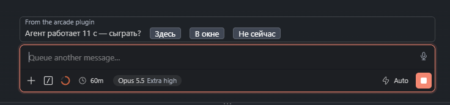

# Arcade — играй, читай, слушай и смотри, пока агент Claude Code работает

[English](README.md) · **Русский** · [Українська](README.uk.md) · [Español](README.es.md) · [Français](README.fr.md) · [Deutsch](README.de.md) · [Português](README.pt.md) · [Italiano](README.it.md) · [Polski](README.pl.md) · [Türkçe](README.tr.md) · [日本語](README.ja.md) · [中文](README.zh.md) · [한국어](README.ko.md)

> **Альфа-версия (0.26).** Arcade работает и используется каждый день, но это ранняя версия: что-то может сломаться, а настройки и каталог — меняться от обновления к обновлению. Сообщения об ошибках очень помогают — см. [Обратная связь](#обратная-связь).

Arcade — мод для [Claude Code](https://claude.com/claude-code), который занимает паузу, пока агент работает. Когда агент думает дольше 10 секунд, над строкой ввода появляется короткое *«сыграть?»*. Сыграй — Денди, Sega, PlayStation, Doom, шахматы и другие, — почитай книгу, послушай аудиокнигу или подкаст, посмотри видео по теме работы агента. Arcade сам скажет, когда агент закончил или ждёт разрешения, так что ничего не пропустишь.

Всё в каталоге бесплатное: игры — под открытыми лицензиями, книги и аудиокниги — из общественного достояния. Можно играть и по сети — с теми, кто тоже ждёт своего агента, — и переписываться с друзьями.



## Возможности

- **Появляется сам.** После 10 секунд работы агента Arcade предлагает сыграть над строкой ввода и не перехватывает фокус, пока ты сам не захочешь.
- **Знает, что делает агент.** Когда агент закончил или просит разрешения, поверх игры появляется плашка: играть дальше, пауза или сразу к агенту — как настроишь. В Claude Desktop он может и закрыть вкладку, где ты смотришь, — и перед тобой снова разговор.
- **Одно меню, шесть разделов.** «Играть», «Читать и слушать», «Смотреть», «Общение», «Работа» и «Ещё» — ненужные можно свернуть. Сверху — «Продолжить» последнюю игру, «Найти» и «Избранное».
- **61 бесплатная игра:** Денди, Sega Mega Drive, Master System, PlayStation и вкладка «Игры» — аркады, шутеры, гонки, стратегии, квесты и настольные.
- **Читать и слушать.** 136 книг из общественного достояния, аудиокниги LibriVox, свежие статьи и выпуски подкастов по теме работы агента.
- **Смотреть.** Свежие видео YouTube по теме работы агента, Twitch: свои каналы и эфиры о программировании, технике, науке и ретро-играх, и TikTok: лента «Для тебя» и поиск на самом сайте TikTok, куда ты входишь сам.
- **Денди и Flappy Arcade прямо в Claude Code** — в терминале, VS Code и Claude Desktop. Всё остальное открывается в окне браузера, а в Claude Desktop — по умолчанию во встроенном браузере Claude (шутеры всё равно окном браузера: встроенный браузер не даёт захватить мышь).
- **Игра по сети.** Игры на двоих для приставок, deathmatch и кооператив в Doom, шахматы, го, шашки и реверси — с людьми или с компьютером.
- **«Кто ждёт в сети».** Arcade показывает в Claude Code, если кто-то ждёт партнёра, и даёт кнопку «Присоединиться».
- **Друзья и чаты.** Вход через GitHub — по желанию: настройки одни на всех твоих компьютерах и свой @ник; друзья — по точному @нику, видно, кто в сети, можно позвать сыграть, переписка один на один и в группах.
- **Блокнот и доски проектов.** Страницы, подстраницы и чек-листы, которые ведёт и Claude; страницу можно отправить в Notion или другое приложение и забрать оттуда через коннекторы Claude; надиктуй в поле ввода Claude и перенеси текст на страницу. Доски с колонками и карточками — поделись доской с друзьями, и все работают на одной.
- **Поиск и избранное.** Один поиск по играм, книгам, аудиокнигам и каналам Twitch, с разбивкой по разделам и жанрам; звёздочка ☆ кладёт что угодно в «★ Избранное».
- **Свои игры.** Можно добавить свои ROM — они остаются у тебя на компьютере.
- **13 языков интерфейса:** English, Русский, Українська, Español, Français, Deutsch, Português, Italiano, Polski, Türkçe, 日本語, 中文, 한국어 — по языку системы или браузера, по умолчанию английский.

## Установка

Нужен **Claude Code 2.1.275 или новее**.

В терминале — две команды: подключить маркетплейс Arcade (этот репозиторий) и поставить мод из него:

```
claude plugin marketplace add ArbakovMaxim/agent-arcade
claude plugin install arcade@agent-arcade
```

Или внутри сессии Claude Code:

```
/plugin marketplace add ArbakovMaxim/agent-arcade
/plugin install arcade@agent-arcade
```

Мод ставится сразу для всех сессий и приложений. В расширении для VS Code команды `/plugin` нет — поставь мод из терминала, и расширение подхватит его в новом разговоре.

**Обновить:**

```
/plugin marketplace update agent-arcade
/plugin update arcade@agent-arcade
```

**Удалить:** `/plugin uninstall arcade@agent-arcade`

## Как пользоваться

- **`/arcade`** открывает меню в любой момент.
- Когда агент работает дольше 10 секунд, над строкой ввода появляется *«сыграть?»*: **`1`** — здесь, в панели; **`2`** — в окне браузера (где оно доступно); **`3`** — не сейчас.
- Стрелки или Tab — выбрать, Enter — открыть, можно и мышью. Управление каждой игрой написано под ней.
- Когда агент закончил или ждёт разрешения, поверх игры появляется плашка: **«К агенту»** или **«Играть дальше»**.

### Меню

| Раздел | Что внутри |
|---|---|
| *(сверху)* | **▶ Продолжить** последнюю игру, **🔍 Найти**, **★ Избранное** |
| **Играть** | Денди, Sega, Master System, PlayStation, «Игры»; «Присоединиться», когда кто-то ждёт в сети; **«Мои игры»** |
| **Читать и слушать** | Книги, Аудиокниги, Статьи, Подкасты |
| **Смотреть** | YouTube, Twitch, TikTok |
| **Общение** | Друзья, Чаты, **«Войти через GitHub»** (после входа — **«Аккаунт»**) |
| **Работа** | Блокнот, Доска проектов |
| **Ещё** | Окно Arcade, Настройки, 🌐 язык, 🐞 Сообщить об ошибке, ☕ Поддержать проект |

Нажатие на заголовок раздела сворачивает и разворачивает его. У свёрнутого — `▸` и сколько в нём плиток, у «Общения» ещё и новые сообщения 💬 и заявки в друзья 👥. Arcade помнит, какие разделы ты свернул. Со входом в шапке меню — твой @ник с теми же счётчиками.

**Поиск** начинается с двух букв и ищет по названию, автору и жанру, без учёта регистра и знаков над буквами. Найденное разложено по разделам и жанрам — «Книги · Детектив», «Игры · Шутер». Звёздочка ☆ рядом с игрой, книгой или аудиокнигой кладёт её в **«★ Избранное»** (до 100 записей) — там всё разложено по разделам и жанрам, последнее — первым.

### Где что открывается

| | Денди, Flappy Arcade | Sega, Master System, PlayStation, остальные «Игры»; книги, аудиокниги, статьи, подкасты, видео |
|---|---|---|
| **Терминал** | в панели (пикселями, если терминал умеет, иначе символами) | окно браузера |
| **VS Code** | в панели | окно браузера |
| **Claude Desktop** | в панели | встроенный браузер Claude или окно браузера (выбирается в настройках); шутеры — всегда окном браузера |

Окно браузера — отдельное окно Arcade (браузер по умолчанию или тот, что выберешь в настройках), а не вкладка среди твоих обычных. Чаты работают прямо в панели — в терминале и в Desktop; «Открыть на странице» открывает их на сайте тем же способом. Блокнот и доски проектов — в панели. TikTok в Desktop открывается во встроенном браузере Claude, в остальных местах — в браузере по умолчанию, где ты, скорее всего, уже вошёл.

## Каталог

| Вкладка | Что внутри |
|---|---|
| **Денди** | 28 самодельных игр — платформеры, головоломки, шутеры, гонки: Thwaite, Nova the Squirrel, Super Uwol, Lala the Magical и другие |
| **Sega** | 11 игр для Mega Drive: Miniplanets, Tank Battle, Battle 4Tris, Pong и другие |
| **Master System** | 4 игры: Balloon Master, SkyHaul, Food Fighter, Escape from Monster Dimension |
| **PlayStation** | Hello Pong |
| **Игры → Аркады** | Flappy Arcade — своя игра Arcade на одну кнопку: прямо в панели и в окне Arcade; трасса дня одна для всех, рекорд запоминается |
| **Игры → Шутеры** | Freedoom Phase 1 и 2 (свободная замена Doom), deathmatch FreeDM, Blasphemer (свободная замена Heretic), deathmatch BlasphDM |
| **Игры → Гонки** | HexGL — футуристические гонки на антигравитационных кораблях |
| **Игры → Стратегии** | OpenTTD — транспортная стратегия (GPL-2.0); Micropolis — открытый код классического градостроителя 1989 года, город сохраняется в браузере (micropolisJS, GPL-3.0 с дополнительными условиями и Micropolis Public Name License) |
| **Игры → Квесты** | Четыре бесплатных классических квеста 90-х в ScummVM (GPL-3.0-or-later): Beneath a Steel Sky, Flight of the Amazon Queen, Lure of the Temptress и Nippon Safes, Inc. — бесплатные данные игр с правом распространения; сохраняйся в любой момент по F5 |
| **Игры → Настольные** | шахматы — с людьми или с компьютером (Stockfish, сила от 1 до 10), по сети — с часами; го на досках 9×9, 13×13 и 19×19; русские шашки, реверси; везде можно сдаться |
| **Книги** | 136 книг из общественного достояния на полках языков, внутри — по жанрам: 98 на английском (Остин, Диккенс, Твен, Конан Дойл, Уэллс, Шелли, Толстой и Достоевский в переводах…) и 38 на украинском (Франко, Леся Украинка, Коцюбинский, Котляревский, Кулиш…). Закладка ставится сама: открыл книгу снова — ты там, где остановился. Свои EPUB, FB2 и TXT — в том числе русские — открываются в окне Arcade |
| **Аудиокниги** | записи из общественного достояния с LibriVox на полках языков, внутри — по жанрам: Оскар Уайльд и О. Генри на английском, Гоголь на украинском. Проигрыватель в окне Arcade помнит, где ты остановился; свои MP3, M4A, M4B, OGG и Opus открываются там же и остаются в браузере |
| **Статьи** | свежие статьи из 106 отобранных англоязычных блогов и изданий — Simon Willison, InfoQ, The Cloudflare Blog, Ars Technica, Krebs on Security и другие |
| **Подкасты** | свежие выпуски 65 англоязычных подкастов — Software Engineering Daily, Security Now, Talk Python To Me, Darknet Diaries и другие; выпуск помнит, где ты остановился |
| **YouTube** | свежие видео со 153 отобранных каналов по 24 направлениям — от ИИ, веба и DevOps до науки, космоса и ретро-компьютеров |
| **Twitch** | «Мои каналы» — любой канал Twitch по имени или ссылке, эфиры первыми; «Сейчас в эфире» и «Весь каталог» — 26 отобранных англоязычных каналов, без каналов 18+; регистрация не нужна |

У каждой игры в карточке — ссылки на её лицензию и исходники.

**Темы.** Статьи, подкасты и YouTube начинаются с тем: Haiku предлагает три по работе агента и «Новинки и презентации». В поле «Своя тема» можно написать, о чём хочешь смотреть, читать или слушать, на любом языке; последние пять тем остаются плитками «Мои темы».

## Игра по сети

- **Приставки.** У игр на двоих для Денди, Sega, Master System и PlayStation есть кнопка **«По сети»**: создай комнату или войди в чужую. Нажатия синхронизируются по кадрам через сервер Arcade.
- **Doom.** **FreeDM** и **BlasphDM** — лобби deathmatch с раундами по 5 минут, до четырёх игроков; у **Freedoom** и **Blasphemer** — кооператив через **«По сети»**. Кто пришёл посреди раунда, ждёт следующего: в идущий матч движок не пускает.
- **Настольные.** «Найти соперника», «Пригласить друга» по ссылке или «С компьютером». Партия хранится на сервере: сделал ход, вернулся к агенту, открыл ссылку позже — доска на месте. Если у тебя есть @ник, соперник видит его рядом с твоим цветом.
- **Кто ждёт.** Раз в минуту Arcade проверяет, не ждёт ли кто-нибудь партнёра, и показывает это в Claude Code — например *«сыграть? В сети ждут: FreeDM (1)»*, — а в меню появляется кнопка **«Присоединиться»**.

## Аккаунт, друзья и чаты

Вход — по желанию: без него всё остальное работает как раньше.

- **«Войти через GitHub»** (в «Общении»): Arcade показывает код, ты вводишь его на странице GitHub в обычном браузере. Arcade узнаёт только имя и картинку профиля GitHub — ни почты, ни доступа к репозиториям.
- **Синхронизация.** Язык, клавиши, уведомления, размер панели, что делать с игрой по сигналу агента, настройки браузера в Desktop, свои темы, каналы Twitch, избранное, свёрнутые разделы и рекорд Flappy Arcade становятся одними на всех твоих компьютерах. Свои игры, браузер и графика у каждого компьютера свои.
- **@ник.** Возьми имя с GitHub одной кнопкой или придумай свой: от 4 до 32 знаков — латинские буквы, цифры и `_`. Сменить можно до 5 раз в сутки.
- **Друзья.** Друга добавляют по точному @нику: он принимает заявку у себя, и вы появляетесь в списках друг у друга. Подсказок по буквам нет, так что перебирать, кто есть в Arcade, нельзя. Отклонить и удалить — молча.
- **В сети и приглашения в игру.** Пока меню Arcade открыто, друзья видят тебя «в сети», а ты — их; чтобы не показываться, выключи «Показывать друзьям, что я в сети» на экране «Друзья». «Позвать» рядом с другом предлагает сетевые игры: настольная открывает комнату на двоих, Doom — своё лобби. Игра сразу открывается у тебя, а у друга — уведомление и «Принять» вверху меню; приглашение действует 10 минут. Звать можно там, где сетевые игры открываются в браузере, — во встроенном в Desktop или в окне браузера.
- **Чаты.** Один на один с другом, группы из друзей или группа со всеми друзьями одним нажатием. Пиши прямо в панели Arcade или открой страницу чатов на сайте. Переписка хранится на сайте Arcade и не шифруется — не пиши туда пароли и ключи.
- **«Выйти»** прекращает синхронизацию на этом компьютере; **«Удалить аккаунт»** (двумя нажатиями) — сайт забывает тебя и твои настройки.

## Блокнот и доски проектов

Оба — в разделе «Работа» меню.

- **Блокнот.** Страницы и подстраницы; строка с `# ` — заголовок, с `- ` — пункт, с `- [ ] ` — пункт чек-листа, который отмечается нажатием. Хранится на этом компьютере — до 200 страниц, 20 000 знаков на странице.
- **Claude ведёт его тоже.** «Отдать Claude» передаёт страницу Claude, или просто попроси Claude записать что-нибудь в Arcade. Claude пользуется инструментом `mcp__arcade__notes`, который меняет только блокнот и ничего не удаляет. Не понравилась правка Claude — «Вернуть текст до правки Claude».
- **Notion и другие приложения** — через коннекторы Claude, так что ключи и пароли Arcade не нужны: «Отправить в Notion», «В другое приложение», «Забрать из Notion или другого приложения». Связанную страницу можно обновить в приложении или снова забрать оттуда.
- **Голосом.** Надиктуй в поле ввода Claude системной диктовкой (Win+H в Windows, дважды Fn в macOS) и нажми «Взять из поля ввода Claude» — текст перейдёт в конец страницы.
- **Доска проектов.** Колонки — «Сделать», «В работе», «Готово» или свои, до 8 — и карточки; карточка — страница блокнота с текстом и чек-листом. Нажми на карточку, чтобы выбрать её и переносить стрелками, ещё раз — открыть. Claude тоже ведёт доски: «Отдать Claude» или попроси разложить задачи по доске в Arcade.
- **Общие доски.** Со входом и @ником отметь друзей и нажми «Поделиться»: карточки, колонки и название у всех одни, а правки доходят за секунды. Хозяин зовёт ещё друзей, убирает участников и удаляет доску с сайта; выйти может любой; что бы ни случилось, у каждого остаётся своя копия. Своих общих досок — до 3, на доске до 20 человек и 200 карточек.

## Свои игры

- **`/arcade-add <файл>`** добавляет ROM для Денди, Mega Drive или Master System (до 4 МБ). Мод хранит копию в `~/.claude/arcade` и никуда её не отправляет.
- **Диски PlayStation и WAD для Doom** (например, купленный `doom.wad`) — в окне Arcade: **«Открыть свой файл»**. Они остаются только в этом браузере.

Добавляй только файлы, на которые у тебя есть права.

## Настройки

В меню `/arcade` → раздел «Ещё» → **«Настройки»**:

- **Язык** — один из 13 (то же — прямо в меню: 🌐).
- **Где открывать игры** — здесь, в панели, в окне браузера или в конкретном браузере; в Claude Desktop — во встроенном браузере Claude или в окне браузера.
- **Графика** (в терминале) — пиксели в терминалах с картинками (kitty, Ghostty, Rio), символы — везде.
- **Размер панели** — обычный или во всю ширину.
- **Когда агент закончил** — плашка и игра идёт, пауза с плашкой или сразу к агенту.
- **Когда агент ждёт разрешения** — те же три варианта.
- **Когда открывается браузер** (Claude Desktop) — закрывать меню Arcade, чтобы браузер был во всю высоту, или оставлять меню над ним.
- **Агент закончил, пока смотришь** (Claude Desktop) — закрыть вкладку, где Arcade открыл видео, трансляцию, TikTok, статью или выпуск, и перед тобой снова разговор с Claude, или только сообщить.
- **Уведомления, пока играешь в окне.**
- **Проверка клавиш и переназначение** (в терминале).

## Приватность

- Без рекламы, аналитики и слежки. Если игра пришла со счётчиком, он вырезан — это написано в `NOTICE` игры.
- Твои ROM, WAD, книги и файлы аудиокниг не покидают компьютер или браузер.
- Игра по сети идёт через сервер Arcade на Cloudflare: сообщения пересылаются между игроками комнаты и не хранятся. Исключение — ходы настольных игр: они хранятся, чтобы можно было вернуться к партии, а партия, которую месяц не трогали, удаляется.
- Темы предлагает Haiku в твоей же сессии Claude Code; сайт Arcade разговора не видит — только короткий английский запрос, когда ты пишешь «Свою тему». Адрес статьи идёт после `#` и не уходит на сервер Arcade.
- Со входом сайт хранит синхронизированные настройки, избранное, @ник, друзей, чаты и общие доски, а приглашения в игру — 10 минут. Кто в сети, он держит только в памяти, полторы минуты. Ключ сессии уходит только на сайт Arcade.
- Блокнот остаётся на твоём компьютере. Общие доски хранятся на сайте Arcade и не шифруются, как и чаты. В Notion или другое приложение страницы уходят, только когда ты попросишь, через твои же коннекторы Claude.
- В отчёте об ошибке — твой текст, версия Arcade, где он открыт, язык интерфейса и система, больше ничего; без входа отчёт уходит без подписи, а адреса сайт не хранит.
- Некоторые игры выходят в интернет только по твоему желанию — например, необязательный опрос OpenTTD и его кнопка «Онлайн-контент».

## Платформы и статус

Arcade — в **альфа-версии** и активно развивается; что нового — в [списке изменений](CHANGELOG.md).

- Проверено вживую на Windows, macOS и Linux.
- Работает в терминале, в VS Code и в Claude Desktop.

## Лицензии

- **Игры:** у каждой своя свободная лицензия (MIT, GPL, BSD, Apache, Creative Commons и другие) — текст лицензии и исходники лежат рядом с игрой, ссылки есть в её карточке.
- **Книги и аудиокниги:** общественное достояние — английские книги с Project Gutenberg, украинские с Викитеки, записи с LibriVox; у каждой книги — `LICENSE.txt` с источником.
- **Эмуляторы и движки:** JSNES (Apache-2.0), EmulatorJS (GPL-3.0) с ядрами, PrBoom (GPL-2.0), doom-wasm от Cloudflare и Chocolate Doom/Heretic (GPL-2.0), OpenTTD (GPL-2.0), micropolisJS (GPL-3.0 с дополнительными условиями), ScummVM (GPL-3.0-or-later), Stockfish (GPL-3.0) — компьютер в шахматах. Ядро Genesis Plus GX, на котором идут Sega и Master System, разрешено только для некоммерческого использования.
- **Собственный код Arcade** (мод и сайт) — **GNU AGPL-3.0** ([LICENSE](LICENSE)), © 2026 Max Arbakov. Его можно свободно использовать, изучать и менять. Но кто распространяет изменённую версию — или запускает её как онлайн-сервис для других людей, — обязан опубликовать свои исходники целиком под той же лицензией и сохранить указание авторства. У сторонних компонентов — свои лицензии.

## Поддержать проект

Arcade бесплатный. Если с ним ждать агента веселее, можно угостить проект кофе — совершенно добровольно: **[ko-fi.com/agentarcade](https://ko-fi.com/agentarcade)**. Та же ссылка есть внизу меню `/arcade` («☕ Поддержать проект») и в окне Arcade. Ничего в Arcade от этого не зависит, и игру она никогда не прерывает.

## Обратная связь

Нашёл ошибку? Быстрее всего — прямо в Arcade: **«Ещё» → «🐞 Сообщить об ошибке»**. Опиши, что сломалось, и отчёт уйдёт прямо автору Arcade вместе с версией, местом запуска, языком и системой.

Можно и открыть [issue](https://github.com/ArbakovMaxim/agent-arcade/issues) — с ошибкой или идеей. Напиши, пожалуйста, систему, где запускал Claude Code (терминал, VS Code или Desktop), и игру.

Pull request'ы приветствуются. Отправляя его, ты соглашаешься, что твой вклад распространяется под AGPL-3.0 и что автор может предлагать Arcade и на других условиях (например, по коммерческой лицензии).

## Разработчикам

```
mod/     мод для Claude Code (хуки, интерфейс панели, тесты)
site/    сайт на Cloudflare Workers: каталог, окно Arcade, комнаты для сетевой игры, аккаунты, друзья, чаты, отчёты об ошибках
tools/   помощники сборки: книги, аудиокниги, переводы, heretic-wasm
.github/ сборки doom-wasm, heretic-wasm, OpenTTD и ScummVM для браузера в GitHub Actions
```

- Запустить мод из репозитория: `claude --plugin-dir ./mod`
- Тесты мода: `claude plugin validate ./mod`, потом `claude plugin test` в `mod/`
- Тесты сайта: `npm test` в `site/`; сборка — `node build.mjs`; выкладка — автоматически из `main` через Cloudflare Workers Builds.
- Книги: `node tools/books/build.mjs` скачивает и чистит книги каталога (список — `tools/books/books.json`).
- Переводы: `node tools/i18n/collect.mjs`, потом `node tools/i18n/check.mjs` — см. [tools/i18n/README.md](tools/i18n/README.md).

Подробности: [mod/README.md](mod/README.md) — устройство мода, [site/README.md](site/README.md) — сайт, как добавить игру, сетевая игра.
