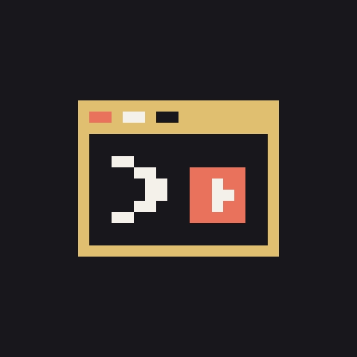

# Arcade — Claude Code ajanın çalışırken oyna, oku, dinle ve izle

[English](README.md) · [Русский](README.ru.md) · [Українська](README.uk.md) · [Español](README.es.md) · [Français](README.fr.md) · [Deutsch](README.de.md) · [Português](README.pt.md) · [Italiano](README.it.md) · [Polski](README.pl.md) · **Türkçe** · [日本語](README.ja.md) · [中文](README.zh.md) · [한국어](README.ko.md)

> **Beta (0.35).** Burada anlatılan her şey çalışıyor ve her gün kullanılıyor; bundan sonra değişenler çoğunlukla ayrıntılar. Hata bildirimlerine çok seviniriz — bkz. [Geri bildirim](#geri-bildirim).

Arcade, ajanın çalışırken bekleme süresini dolduran bir [Claude Code](https://claude.com/claude-code) eklentisidir. Ajan 10 saniyeden uzun süre meşgul olduğunda, istemin üstünde küçük bir *«oynamak ister misin?»* belirir. Bir şeyler oyna — NES, Sega, PlayStation, Doom, satranç ve daha fazlası —, bir kitap oku, bir sesli kitap ya da podcast dinle veya ajanın üzerinde çalıştığı konuyla ilgili bir video izle. Ajan işini bitirdiği ya da iznine ihtiyaç duyduğu anda Arcade sana haber verir — hiçbir şeyi kaçırmazsın.

Katalogdaki her şey ücretsiz: oyunlar açık lisanslı, kitaplar ve sesli kitaplar kamu malı. Ajanlarını bekleyen başka kişilerle çevrim içi oynayabilir ve arkadaşlarınla sohbet edebilirsin.


*Claude Desktop’ta 31 saniye, arayüz İngilizce. [Videoyu 720p izle](https://github.com/user-attachments/assets/1c21bf5c-f5c7-4671-a453-bdcf6aa4b287).*

## Özellikler

- **Kendiliğinden belirir.** Ajan 10 saniye çalıştıktan sonra Arcade istemin üstünde bir oyun önerir; sen istemedikçe odağı asla almaz.
- **Ajanın ne yaptığını bilir.** Ajan bitirdiğinde ya da izin istediğinde oyunun üstünde bir bildirim çıkar — oynamaya devam et, duraklat ya da doğrudan ajana dön (davranışı ayarlardan seçersin). Claude Desktop’ta izlediğin sekmeyi de kapatabilir, böylece sohbet yeniden önüne gelir.
- **Tek menü, altı bölüm.** *Oyna*, *Oku ve dinle*, *İzle*, *Sosyal*, *İş* ve *Diğer* — ihtiyacın olmayanları daralt. En üstte: son oyuna *Devam et*, *Ara* ve *Favoriler*. Arcade’i ilk açtığında hangi bölümlerin görüneceğini seçersin.
- **61 ücretsiz oyun:** NES (Dendy), Sega Mega Drive, Master System, PlayStation ve arcade oyunları, nişancı, yarış, strateji, macera ve masa oyunları içeren bir *Oyunlar* sekmesi.
- **Oku ve dinle.** 30 dilde klasikler ve LibriVox sesli kitapları, doğrudan Project Gutenberg, Vikikaynak ve LibriVox’tan; ayrıca ajanın üzerinde çalıştığı konuyla ilgili yeni makaleler ve podcast bölümleri.
- **İzle.** Ajanın üzerinde çalıştığı konuyla ilgili yeni YouTube videoları, Twitch: kendi kanalların ile programlama, teknoloji, bilim ve retro oyunlar üzerine canlı yayınlar ve TikTok: girişi kendin yaptığın TikTok’un kendi sitesinde *Sana Özel* akışı ve arama.
- **NES ve Flappy Arcade doğrudan Claude Code içinde** — terminalde, VS Code’da ve Claude Desktop’ta. Geri kalan her şey bir tarayıcı penceresinde açılır; Claude Desktop’ta varsayılan olarak Claude’un yerleşik tarayıcısında (nişancı oyunları yine de tarayıcı penceresinde açılır: yerleşik tarayıcı fareyi yakalayamaz).
- **Çevrim içi oyun.** Ağ üzerinden iki kişilik konsol oyunları, Doom’da deathmatch ve co-op, insanlara ya da bilgisayara karşı satranç, go, dama ve reversi.
- **«Çevrim içi kim bekliyor».** Biri oyun arkadaşı beklediğinde Arcade bunu Claude Code’da bir *Katıl* düğmesiyle gösterir.
- **Arkadaşlar ve sohbetler.** İsteğe bağlı GitHub girişi ayarlarını tüm bilgisayarlarında aynı tutar ve sana bir @takma ad verir; arkadaşlarını tam takma adlarıyla ekle, kimin çevrimiçi olduğunu gör, onları oyuna davet et, ikili ya da grup halinde sohbet et.
- **Defter ve proje panoları.** Claude’un da tuttuğu sayfalar, alt sayfalar ve kontrol listeleri; Claude’un bağlayıcılarıyla bir sayfayı Notion’a ya da başka bir uygulamaya gönder veya oradan al; Claude’un giriş kutusuna dikte et ve metni bir sayfaya taşı. Sütunlu ve kartlı panolar — birini arkadaşlarınla paylaş, herkes aynı pano üzerinde çalışsın.
- **Arama ve favoriler.** Oyunlarda ve Twitch kanallarında tek bir arama, bölüme ve türe göre gruplanmış; *★ Favoriler*’de tutmak için bir oyunu ☆ ile işaretle.
- **Kendi oyunların.** Sahip olduğun ROM’ları ekle; bilgisayarında kalırlar.
- **13 arayüz dili:** English, Русский, Українська, Español, Français, Deutsch, Português, Italiano, Polski, Türkçe, 日本語, 中文, 한국어 — sistem ya da tarayıcı diline göre, varsayılan İngilizce.

## Kurulum

**Claude Code 2.1.275 veya daha yenisi** gerekir.

Terminalde iki komut: Arcade marketplace’ini (bu depo) ekle, ardından eklentiyi oradan kur:

```
claude plugin marketplace add ArbakovMaxim/agent-arcade
claude plugin install arcade@agent-arcade
```

Ya da bir Claude Code oturumunun içinde:

```
/plugin marketplace add ArbakovMaxim/agent-arcade
/plugin install arcade@agent-arcade
```

Eklenti tüm oturumlar ve uygulamalar için kurulur. VS Code eklentisinde `/plugin` komutu yok — terminalden kur, VS Code eklentisi yeni bir sohbette onu algılar.

**Güncelleme:**

```
/plugin marketplace update agent-arcade
/plugin update arcade@agent-arcade
```

Ardından Claude Code’u yeniden başlat. Marketplace yalnızca eklentiyi indirir — birkaç MiB, site olmadan — bu yüzden güncelleme saniyeler sürer. Arcade zaten kuruluysa bir şey yapmana gerek yok: marketplace bir sonraki güncellemede kendiliğinden geçiş yapar.

`/plugin update` *already at the latest version* diyor ama Arcade’in yeni sürümü çıkmışsa marketplace yenilenmemiştir. Nedenini görmek için terminalde `claude plugin marketplace update agent-arcade` komutunu çalıştır. *timed out* yazıyorsa klonlamaya 10 dakika ver:

```
CLAUDE_CODE_PLUGIN_GIT_TIMEOUT_MS=600000 claude plugin marketplace update agent-arcade
```

PowerShell’de: `$env:CLAUDE_CODE_PLUGIN_GIT_TIMEOUT_MS=600000; claude plugin marketplace update agent-arcade`. Ardından `/plugin update arcade@agent-arcade` komutunu yeniden çalıştır.

**Kaldırma:** `/plugin uninstall arcade@agent-arcade`

## Kullanım

- **`/arcade`** menüyü istediğin an açar.
- Ajan 10 saniyeden uzun çalıştığında istemin üstünde *«oynamak ister misin?»* belirir: **`1`** — burada, panelde oyna; **`2`** — bir tarayıcı penceresinde (olan yerlerde); **`3`** — şimdi değil. Ayarlar → Bildirimler’den ne zaman görüneceğini — 10 saniyeden 5 dakikaya kadar — seçebilir ya da kapatabilirsin.
- Seçmek için oklar ya da Tab, açmak için Enter; fare de çalışır. Kontroller her oyunun altında yazılı.
- Ajan bitirdiğinde ya da izin beklediğinde oyunun üstünde bir bildirim çıkar: **Ajana dön** ya da **Oynamaya devam et**.

### Menü

| Bölüm | İçinde ne var |
|---|---|
| *(en üst)* | Son oyuna **▶ Devam et**, **🔍 Ara**, **★ Favoriler** |
| **Oyna** | NES, Sega, Master System, PlayStation, Oyunlar; biri çevrim içi beklerken *Katıl*; **Oyunlarım** |
| **Oku ve dinle** | Kitaplar, Sesli kitaplar, Makaleler, Podcast’ler |
| **İzle** | YouTube, Twitch, TikTok |
| **Sosyal** | Arkadaşlar, Sohbetler, **GitHub ile giriş yap** (giriş yaptıktan sonra **Hesap**) |
| **İş** | Defter, Proje panosu |
| **Diğer** | Arcade penceresi, Ayarlar, 🌐 dil, 🐞 Hata bildir, ☕ Projeye destek ol |

Bir bölümü daraltmak ya da genişletmek için başlığına tıkla. Daraltılmış bölüm `▸` ve içindeki kutucuk sayısını gösterir; *Sosyal* ayrıca yeni mesajları 💬 ve arkadaşlık isteklerini 👥 gösterir. Arcade hangi bölümlerin daraltıldığını hatırlar. İhtiyacın olmayan bir bölümü **Ayarlar**’dan gizleyebilirsin: başlığı ve kutucuklarıyla birlikte menüden tamamen kalkar; ayarların bulunduğu *Diğer* her zaman kalır. Giriş yaptıktan sonra menü başlığı @takma adını aynı sayaçlarla gösterir.

**Arama** iki harften itibaren başlar ve büyük-küçük harf ile aksanlara bakmadan başlık ya da tür bulur. Sonuçlar bölüme ve türe göre gruplanır, örneğin *Oyunlar · Nişancı*. Bir oyunun yanındaki ☆ yıldızı onu **★ Favoriler**’e ekler (en fazla 100); favoriler bölüme ve türe göre sıralanır, en yeniler önce. Kitapların ve sesli kitapların başlığa ya da yazara göre kendi araması var.

### Ne nerede açılır

| | NES (Dendy), Flappy Arcade | Sega, Master System, PlayStation, diğer Oyunlar; kitaplar, sesli kitaplar, makaleler, podcast’ler, videolar |
|---|---|---|
| **Terminal** | panelde (terminal destekliyorsa piksel grafik, değilse metin blokları) | tarayıcı penceresi |
| **VS Code** | panelde | tarayıcı penceresi |
| **Claude Desktop** | panelde | Claude’un yerleşik tarayıcısı ya da tarayıcı penceresi (ayarlardan seçilir); nişancı oyunları — her zaman tarayıcı penceresi |

Tarayıcı penceresi ayrı bir Arcade penceresidir (varsayılan tarayıcında ya da ayarlarda seçtiğin tarayıcıda), sıradan sekmelerinin arasında bir sekme değil. Sohbetler doğrudan panelde çalışır — terminalde ve Desktop’ta; *Sayfada aç* onları sitede aynı şekilde açar. Defter ve proje panoları panelde çalışır. TikTok, Desktop’ta Claude’un yerleşik tarayıcısında, diğer yerlerde ise büyük ihtimalle zaten giriş yapmış olduğun varsayılan tarayıcında açılır.

## Katalog

| Sekme | İçinde ne var |
|---|---|
| **NES (Dendy)** | 28 homebrew oyun — platform, bulmaca, nişancı, yarış: Thwaite, Nova the Squirrel, Super Uwol, Lala the Magical ve diğerleri |
| **Sega** | 11 Mega Drive oyunu: Miniplanets, Tank Battle, Battle 4Tris, Pong ve diğerleri |
| **Master System** | 4 oyun: Balloon Master, SkyHaul, Food Fighter, Escape from Monster Dimension |
| **PlayStation** | Hello Pong |
| **Oyunlar → Arcade oyunları** | Flappy Arcade — Arcade’in kendi tek tuşlu oyunu: doğrudan panelde ve Arcade penceresinde çalışır; günün parkuru herkes için aynıdır, rekorun kaydedilir |
| **Oyunlar → Nişancı** | Freedoom Phase 1 ve 2 (Doom’un özgür alternatifleri), FreeDM deathmatch, Blasphemer (Heretic’in özgür alternatifi), BlasphDM deathmatch, OpenArena — Quake III motoruyla botlara karşı arena nişancı oyunu (GPL-2.0) |
| **Oyunlar → Yarış** | HexGL — fütüristik yerçekimsiz yarış |
| **Oyunlar → Strateji** | OpenTTD — ulaşım imparatorluğu (GPL-2.0); Micropolis — 1989’un klasik şehir kurma oyununun açık kaynak kodu, şehrin tarayıcıda kaydedilir (micropolisJS, ek koşullarla GPL-3.0 ve Micropolis Public Name License); Warzone 2100 — kampanyası ve bilgisayara karşı çatışması olan gerçek zamanlı strateji, birliklerini kendin tasarlarsın, kayıtlar tarayıcıda kalır (GPL-2.0-or-later) |
| **Oyunlar → Macera** | ScummVM’de (GPL-3.0-or-later) 90’ların dört ücretsiz klasik macera oyunu: Beneath a Steel Sky, Flight of the Amazon Queen, Lure of the Temptress ve Nippon Safes, Inc. — izinle dağıtılabilen freeware oyun verileri; F5 ile istediğin an kaydet |
| **Oyunlar → Masa oyunları** | Satranç — insanlara ya da bilgisayara karşı (Stockfish, 1–10 seviye), çevrim içi saatli; 9×9, 13×13 ve 19×19 tahtalarda go; Rus daması, reversi; hepsinde *Terk et* |
| **Kitaplar** | 30 dilde kamu malı klasikler — dili sen seçersin (başta arayüzün dili). Bölümler her dilde aynı: Popüler, Kurmaca, Şiir, Tiyatro, Macera, Polisiye ve diğerleri; başlığa ya da yazara göre arama yapılır. Liste istek üzerine Project Gutenberg ve Vikikaynak’tan gelir — Arcade’in kendi kitabı yoktur; açtığın kitap tarayıcındaki *Kitaplarım* bölümünde kalır. Ayraç kendiliğinden konur: kitabı yeniden aç, kaldığın yerden devam edersin. Kendi EPUB, FB2 ve TXT dosyaların da Arcade penceresinde açılır |
| **Sesli kitaplar** | Aynı dillerde ve bölümlerde LibriVox kayıtları, aramayla birlikte: doğrudan archive.org’dan çevrim içi dinle ya da çevrim dışı dinlemek için kitabı tarayıcına indir. Arcade penceresindeki oynatıcı kaldığın bölümü, yeri ve hızı hatırlar; kendi MP3, M4A, M4B, OGG ve Opus dosyaların da orada açılır ve tarayıcında kalır |
| **Makaleler** | Seçilmiş 106 İngilizce blog ve yayından yeni makaleler — Simon Willison, InfoQ, The Cloudflare Blog, Ars Technica, Krebs on Security ve diğerleri |
| **Podcast’ler** | 65 İngilizce podcast’in yeni bölümleri — Software Engineering Daily, Security Now, Talk Python To Me, Darknet Diaries ve diğerleri; her bölüm kaldığın yeri hatırlar |
| **YouTube** | Yapay zekâ, web ve DevOps’tan bilime, uzaya ve retro bilgisayarlara kadar 24 alanda seçilmiş 153 kanaldan yeni videolar |
| **Twitch** | *Kanallarım* — adıyla ya da bağlantısıyla herhangi bir Twitch kanalı, yayında olanlar önce; *Şu an yayında* ve *Tüm katalog* — seçilmiş 26 İngilizce kanal, 18+ kanal yok; kayıt gerekmez |

Her oyunun kartı lisansına ve kaynak koduna bağlantı verir.

**Konular.** Makaleler, Podcast’ler ve YouTube konularla başlar: Haiku, ajanın üzerinde çalıştığı şeyle ilgili üç konu önerir, artı *Yenilikler ve tanıtımlar*. *Kendi konun*’a ne izlemek, okumak ya da dinlemek istediğini herhangi bir dilde yazabilirsin; son beş konun *Konularım*’da kutucuk olarak kalır.

## Çevrim içi oyun

- **Konsollar.** NES, Sega, Master System ve PlayStation’daki iki kişilik oyunlarda **Çevrim içi** düğmesi var: bir oda oluştur ya da başkasının odasına katıl. Kontroller Arcade sunucusu üzerinden kare kare eşitlenir.
- **Doom.** **FreeDM** ve **BlasphDM**, en fazla dört oyuncu için 5 dakikalık turlarla deathmatch lobileridir; **Freedoom** ve **Blasphemer** **Çevrim içi** üzerinden co-op sunar. Yeni gelenler bir sonraki turu bekler — motor süren bir maça katılmaya izin vermez.
- **Masa oyunları.** *Rakip bul*, bağlantıyla *Arkadaşını davet et* ya da *Bilgisayara karşı*. Oyun sunucuda saklanır: hamleni yap, ajanına dön, bağlantıyı sonra aç — tahta bıraktığın gibi durur. @takma adla giriş yaptıysan rakibin onu senin renginin yanında görür.
- **Kim bekliyor.** Arcade dakikada bir, oyun arkadaşı bekleyen biri olup olmadığını kontrol eder ve bunu Claude Code’da gösterir — örneğin *«oynamak ister misin? Çevrim içi bekleyen var: FreeDM (1)»* — menüde bir **Katıl** düğmesiyle.

## Hesap, arkadaşlar ve sohbetler

Giriş yapmak isteğe bağlı — giriş yapmadan da her şey eskisi gibi çalışır.

- **GitHub ile giriş yap** (*Sosyal* içinde): GitHub’ın giriş sayfası her zamanki tarayıcında açılır; orada onayla, sonra Arcade sayfasında *Sign in*’e tıkla — sayfadaki kod paneldekiyle aynı olmalı. Tarayıcı üzerinden olmazsa *Kodla giriş yap*: Arcade bir kod gösterir, sen de onu GitHub sayfasına girersin. Arcade yalnızca GitHub profilinin adını ve resmini öğrenir — e-posta yok, depolara erişim yok.
- **Eşitleme.** Dil, tuşlar, bildirimler, panel boyutu, ajan haber verdiğinde oyunla ne yapılacağı, Desktop’taki tarayıcı seçenekleri, konuların, Twitch kanalların, favorilerin, daraltılmış ve gizlenmiş bölümler ve Flappy Arcade rekorun tüm bilgisayarlarında aynı olur. Kendi oyunların, tarayıcı ve grafik modu her bilgisayarda ayrı kalır.
- **@takma ad.** GitHub adını tek tıkla al ya da kendin uydur: 4 ila 32 karakter — Latin harfleri, rakamlar ve `_`. Günde en fazla 5 kez değiştirebilirsin.
- **Arkadaşlar.** Bir arkadaşını tam @takma adıyla ekle: istek karşı tarafta kabul edilir ve birbirinizin listesinde görünürsünüz. Yazarken öneri çıkmaz, bu yüzden kimse Arcade’i kimlerin kullandığına göz atamaz. Reddetmek ve silmek sessizce olur.
- **Çevrimiçi durum ve oyun davetleri.** Arcade menüsü açıkken arkadaşların seni *çevrimiçi* görür, sen de onları; görünmek istemiyorsan *Arkadaşlar* ekranında *Arkadaşlarıma çevrimiçi olduğumu göster* ayarını kapat. Bir arkadaşın yanındaki *Davet et* ağ oyunlarını sunar: bir masa oyunu ikiniz için ayrı bir oda, bir Doom oyunu kendi lobisini açar. Oyun sende hemen açılır; arkadaşına bir bildirim ve menünün üstünde *Kabul et* gelir, davet 10 dakika geçerlidir. Ağ oyunlarının tarayıcıda açıldığı yerlerden davet edebilirsin: Desktop’taki yerleşik tarayıcı ya da bir tarayıcı penceresi.
- **Sohbetler.** Bir arkadaşınla ikili, arkadaş grupları ya da tek tıkla tüm arkadaşlarınla bir grup. Doğrudan Arcade panelinde yaz ya da sitedeki sohbet sayfasını aç. Mesajlar Arcade sitesinde saklanır ve şifrelenmez — oraya parola ya da anahtar yazma.
- **Avatarlar ve mesaj bildirimleri.** *Hesap* bölümünde 24 hazır avatardan birini seç — sohbetler onu yalnızca gösterir; avatar yoksa @takma adının ilk harfi görünür. Bir grubun resmini sahibi aynı 24 resim arasından seçer. GitHub resmin başkalarına asla gösterilmez. Bir arkadaşın yazdığında sol altta tüm pencerelerin üstünde bir kart açılır (Windows) ya da bir sistem bildirimi gelir (macOS, Linux); karta tıklamak o sohbeti açar.
- **Çıkış yap** bu bilgisayarda eşitlemeyi durdurur; **Hesabı sil** (iki kez bas) sitenin seni ve ayarlarını unutmasını sağlar.

## Defter ve proje panoları

İkisi de menünün *İş* bölümünde.

- **Defter.** Sayfalar ve alt sayfalar; `# ` ile başlayan satır başlık, `- ` ile başlayan madde, `- [ ] ` ile başlayan ise basınca işaretlenen bir kontrol listesi maddesidir. Bu bilgisayarda tutulur — en fazla 200 sayfa, sayfa başına 20.000 karakter.
- **Claude da tutar.** *Claude’a ver* sayfayı Claude’a iletir; ya da sadece Claude’dan Arcade’e bir şey not etmesini iste. Claude, yalnızca defteri değiştiren ve hiçbir şey silmeyen `mcp__arcade__notes` aracını kullanır. Claude’un düzenlemesini beğenmezsen: *Claude’un düzenlemesinden önceki metni geri getir*.
- **Notion ve diğer uygulamalar** — Claude’un bağlayıcılarıyla, bu yüzden Arcade’in anahtara ya da parolaya ihtiyacı yok: *Notion’a gönder*, *Başka bir uygulamaya*, *Notion’dan veya başka bir uygulamadan içe aktar*. Bağlı bir sayfa uygulamada güncellenebilir ya da oradan yeniden içe aktarılabilir.
- **Sesle.** Sistemin kendi dikte özelliğiyle Claude’un giriş kutusuna dikte et (Windows’ta Win+H, macOS’ta iki kez Fn), sonra *Claude’un giriş kutusundan al*’a bas — metin sayfanın sonuna taşınır.
- **Proje panosu.** Sütunlar — *Yapılacak*, *Yapılıyor*, *Bitti* ya da kendi sütunların, en fazla 8 — ve kartlar; kart, metin ve kontrol listesi olan bir defter sayfasıdır. Bir kartı seçip oklarla taşımak için ona bas, açmak için bir kez daha bas. Claude da pano yönetebilir: *Claude’a ver* ya da ondan görevleri Arcade’de bir panoya dağıtmasını iste.
- **Ortak panolar.** @takma adla giriş yaptıysan arkadaşlarını işaretle ve *Paylaş*’a bas: herkeste aynı kartlar, sütunlar ve ad olur, değişiklikler birkaç saniye içinde görünür. Sahip başka arkadaşlarını da davet eder, kişileri çıkarır ve panoyu siteden siler; panodan herkes çıkabilir; ne olursa olsun herkesin kendi kopyası kalır. Kendine ait en fazla 3 ortak pano, bir panoda en fazla 20 kişi ve 200 kart.

## Kendi oyunların

- **`/arcade-add <dosya>`** bir NES, Mega Drive ya da Master System ROM’u ekler (en fazla 4 MB). Eklenti bir kopyasını `~/.claude/arcade` içinde tutar ve hiçbir yere yüklemez.
- **PlayStation diskleri ve Doom WAD’ları** (örneğin kendi `doom.wad` dosyan) — Arcade penceresinde: **Kendi dosyanı aç**. Yalnızca o tarayıcıda kalırlar.

Yalnızca hakkına sahip olduğun dosyaları ekle.

## Ayarlar

`/arcade` menüsünün *Diğer* bölümünden **Ayarlar**’ı aç:

- **Ana menü bölümleri** — *Diğer* dışındaki her bölümü göster ya da gizle; gizlenen bölüm, buradan geri getirene kadar menüde hiç görünmez. Aynı seçim Arcade ilk açıldığında da sunulur.
- **Dil** — 13 dilden biri (menüde doğrudan da: 🌐).
- **Oyunları aç** — burada panelde, bir tarayıcı penceresinde ya da belirli bir tarayıcıda; Claude Desktop’ta — Claude’un yerleşik tarayıcısında ya da bir tarayıcı penceresinde.
- **Grafik** (terminal) — resim gösterebilen terminallerde (kitty, Ghostty, Rio) piksel, diğer her yerde metin blokları.
- **Panel boyutu** — normal ya da tam genişlik.
- **Ajan bitirdiğinde** — bildirim ve oynamaya devam, bildirimle duraklatma ya da doğrudan ajana dönüş.
- **Ajan izin istediğinde** — aynı üç seçenek.
- **Tarayıcı açılınca** (Claude Desktop) — tarayıcı tüm yüksekliği kullansın diye Arcade menüsünü kapat ya da menüyü onun üstünde bırak.
- **İzlerken ajan bitirdi** (Claude Desktop) — Arcade’in bir video, yayın, TikTok, makale ya da bölüm için açtığı sekmeyi kapat, böylece Claude ile sohbet yeniden önüne gelir; ya da sadece haber ver.
- **Pencerede oynarken bildirimler.**
- **Mesaj bildirimleri** — bir arkadaşın sohbete yazdığında sol altta bir kart (macOS ve Linux’ta sistem bildirimi).
- **Tuş testi ve tuş atama** (terminal).
- **Koşullar ve gizlilik** — sitenin Kullanım Koşulları ve Gizlilik Politikası, her zamanki tarayıcında açılır.

## Eklenti bilgisayarında ne yapar

Arcade, Claude Code’un eklentilere verdiği erişimle Claude Code içinde çalışır. Kodunun tamamı bu depodadır ve `claude plugin validate ./mod` bağlandığı her olayı ve yaptığı her çağrıyı listeler. Kısaca:

- **Ajanın araçları.** Arcade bir aracın ne zaman başlayıp bittiğini ve ajanın ne zaman izin istediğini görür — bildirimini ne zaman göstereceğini böyle bilir. Ajanın araç çağrılarını asla değiştirmez ya da engellemez. Kendisi yalnızca iki tür çağrıyı onaylar, o da yalnızca Claude Code’un aksi halde sana soracağı yerlerde: yalnızca defteri değiştiren ve hiçbir şey silmeyen `mcp__arcade__notes` ve panelde bastığın bir oyunun Desktop’un yerleşik tarayıcısında açılması. İzin verme ve reddetme kuralların olduğu gibi geçerlidir.
- **Ajanı durdurma.** Yalnızca Claude Desktop’ta, ajan çalışırken yerleşik tarayıcıda bir şey açtığında: Desktop bir eklentinin tarayıcıyı kendi başına açmasına izin vermez. Arcade o anki aracın bitmesini bekler (10 saniye sonra onu keser, ama ekranda bir izin sorusu olduğu sürece bekler), ajanı durdurur ve Claude’dan sayfayı açıp işine dönmesini ister. Bundan kaçınmak için *Ayarlar → Oyunları aç* bölümünden bir tarayıcı penceresi seç.
- **Sohbetin.** Konular için senin oturumundaki Haiku sohbetin sonunu, birkaç bin karakteri alır; bu, Claude kullanımına sayılır. Arcade sitesi sohbeti asla görmez. Arcade giriş kutusuna yalnızca sen istediğinde yazar ya da onu gönderir — örneğin defterdeki *Claude’a ver* — ya da yukarıda anlatıldığı gibi bir sayfa açmak için.
- **Programlar.** Arcade penceresi için tarayıcın (Windows’ta `%LOCALAPPDATA%\claude-arcade` içinde kendi profiliyle); bildirimler — Windows’ta PowerShell, macOS’ta `osascript`, Linux’ta `notify-send`; hangi tarayıcıların kurulu olduğunun (Windows) ya da hangi sistem olduğunun (`uname`) kontrolü.
- **Dosyalar.** Yalnızca `/arcade-add` ile eklediğin ROM’ları `~/.claude/arcade/roms` içine yazar; yalnızca belirttiğin dosyayı, bu kopyaları ve kendi dosyalarını okur. Ayarlar, defter ve favoriler Claude Code’un eklenti deposunda durur.
- **Ortam değişkenleri.** `HOME` ya da `USERPROFILE`, `LANG`, `LC_ALL`, `LC_MESSAGES`, `LOCALAPPDATA` ve `OS` değişkenlerini okur; hiçbirini değiştirmez.
- **Ağ.** Eklentinin kendisi yalnızca Arcade sitesiyle (`agent-arcade.fefaodessa.workers.dev`), YouTube kanallarının RSS akışlarıyla ve gösterdiği blog ve podcast’lerin akışlarıyla konuşur. Desktop panelindeki resimler, örneğin Twitch avatarları, doğrudan bu hizmetlerden yüklenir. Oyunları, kitapları ve videoları tarayıcıda açtığın sayfa yükler.

## Gizlilik

Ayrıntılar sitenin [Gizlilik Politikası](https://agent-arcade.fefaodessa.workers.dev/privacy) ve [Kullanım Koşulları](https://agent-arcade.fefaodessa.workers.dev/terms) sayfalarında; eklentide *Ayarlar → Koşullar ve gizlilik* altında. Kısaca:

- Reklam yok, analiz yok, takip yok. Analiz koduyla gelen oyunlar bundan arındırıldı (her oyunun `NOTICE` dosyasına bak).
- Kendi ROM’ların, WAD’ların, kitapların ve ses dosyaların bilgisayarından ya da tarayıcından asla çıkmaz.
- Kitap ve sesli kitap listeleri ile Project Gutenberg kitapları Arcade sitesi üzerinden gelir: site bunları Project Gutenberg, Vikikaynak ve archive.org’dan alır ve yalnızca Cloudflare önbelleğinde tutar — listeleri altı saat, bir kitabı bir hafta. Vikikaynak sayfalarını ve LibriVox kayıtlarını pencere doğrudan bu sitelerden yükler.
- Çevrim içi oyun Cloudflare üzerindeki Arcade sunucusundan geçer: mesajlar bir odadaki oyuncular arasında aktarılır ve saklanmaz — geri dönebilmen için tutulan masa oyunu hamleleri hariç; bir ay boyunca dokunulmayan oyun silinir.
- Konuları kendi Claude Code oturumunda Haiku önerir; Arcade sitesi sohbetini asla görmez — *Kendi konun*’u kullandığında yalnızca kısa bir İngilizce arama sorgusu gider. Bir makalenin adresi `#` işaretinden sonra gelir, bu yüzden Arcade sunucusuna asla ulaşmaz.
- *Kendi konun* araması YouTube API Services üzerinden yapılır ve videolar YouTube’un kendi oynatıcısında oynar; bu yüzden [YouTube Hizmet Şartları](https://www.youtube.com/t/terms) ve [Google Gizlilik Politikası](https://policies.google.com/privacy) da geçerlidir. Kendi oturumundaki Haiku, başlıklarına ve kısa açıklamalarına bakarak en fazla altı video seçer; Arcade sitesi arama sonuçlarını ortak bir önbellekte bir gün tutar.
- Giriş yaptıktan sonra site eşitlenen ayarlarını, favorilerini, @takma adını, arkadaşlarını, sohbetlerini ve ortak panolarını saklar; oyun davetlerini ise 10 dakika tutar. Kimin çevrimiçi olduğunu yalnızca bellekte, bir buçuk dakika tutar. Oturum anahtarı yalnızca Arcade sitesine gönderilir.
- Defter bilgisayarında kalır. Ortak panolar, tıpkı sohbetler gibi Arcade sitesinde saklanır ve şifrelenmez. Sayfalar Notion’a ya da başka bir uygulamaya yalnızca sen istediğinde, kendi Claude bağlayıcıların üzerinden gider.
- Bir hata raporu metnini, Arcade sürümünü, nerede açık olduğunu, arayüz dilini ve işletim sistemini içerir — başka hiçbir şey; giriş yapmadan imzasız gider ve site hiçbir adres saklamaz.
- Bazı oyunlar internete yalnızca sen istersen çıkar — örneğin OpenTTD’nin isteğe bağlı anketi ve *Online Content* düğmesi.

## Platformlar ve durum

Arcade **beta** aşamasında: özellikler yerinde, çalışmalar ayrıntılarda sürüyor — bkz. [değişiklik günlüğü](CHANGELOG.md).

- Windows, macOS ve Linux’ta canlı olarak denendi.
- Terminalde, VS Code’da ve Claude Desktop’ta çalışır.

## Lisanslar

- **Oyunlar:** her oyunun kendi özgür lisansı var (MIT, GPL, BSD, Apache, Creative Commons ve diğerleri) — lisans metni ve kaynak kodu oyunun yanında durur ve kartından bağlantı verilir.
- **Kitaplar ve sesli kitaplar:** kamu malı; Arcade bunları saklamaz — kitaplar Project Gutenberg ve Vikikaynak’tan, kayıtlar LibriVox’tan (archive.org) sen açtığın anda gelir.
- **Emülatörler ve motorlar:** JSNES (Apache-2.0), çekirdekleriyle EmulatorJS (GPL-3.0), PrBoom (GPL-2.0), Cloudflare’in doom-wasm’ı ve Chocolate Doom/Heretic (GPL-2.0), OpenTTD (GPL-2.0), micropolisJS (ek koşullarla GPL-3.0), ScummVM (GPL-3.0-or-later), Stockfish (GPL-3.0) — satranç rakibi. Sega ve Master System için kullanılan Genesis Plus GX çekirdeği yalnızca ticari olmayan kullanım içindir.
- **Arcade’in kendi kodu** (eklenti ve site) — **GNU AGPL-3.0** ([LICENSE](LICENSE)), © 2026 Max Arbakov. Onu özgürce kullanabilir, inceleyebilir ve değiştirebilirsin. Değiştirilmiş bir sürümü dağıtırsan — ya da başkaları için çevrim içi hizmet olarak çalıştırırsan —, tüm kaynak kodunu aynı lisansla yayımlaman ve telif hakkı bildirimlerini koruman gerekir. Üçüncü taraf bileşenler kendi lisanslarını korur.

## Projeye destek ol

Arcade ücretsiz. Beklemelerini daha keyifli hale getiriyorsa projeye bir kahve ısmarlayabilirsin — tamamen isteğe bağlı: **[ko-fi.com/agentarcade](https://ko-fi.com/agentarcade)**. Aynı bağlantı `/arcade` menüsünün altında (*☕ Projeye destek ol*) ve Arcade penceresinde de var. Arcade’de hiçbir şey buna bağlı değil ve bir oyunu asla bölmez.

## Geri bildirim

Bir hata mı buldun? En hızlı yol doğrudan Arcade’den: **Diğer → 🐞 Hata bildir**. Neyin bozulduğunu anlat, rapor sürüm, ortam, dil ve işletim sistemi bilgisiyle birlikte doğrudan Arcade’in yazarına gider.

Ayrıca bir [issue](https://github.com/ArbakovMaxim/agent-arcade/issues) açabilirsin — hatalar ve fikirler için. İşletim sistemini, Claude Code ortamını (terminal, VS Code ya da Desktop) ve oyunu belirt.

Pull request’ler memnuniyetle karşılanır. Bir tane gönderdiğinde katkının AGPL-3.0 altında lisanslanmasını ve yazarın Arcade’i başka koşullarla da (örneğin ticari bir lisansla) sunabilmesini kabul etmiş olursun.

## Geliştiriciler için

```
mod/     Claude Code eklentisi (hook'lar, panel arayüzü, testler)
site/    Cloudflare Workers üzerindeki site: katalog, Arcade penceresi, ağ odaları, hesaplar, arkadaşlar, sohbetler, hata raporları
tools/   derleme araçları: çeviriler, heretic-wasm
.github/ doom-wasm, heretic-wasm, OpenTTD ve ScummVM'i tarayıcı için derleyen GitHub Actions
```

- Eklentiyi depodan çalıştırmak: `claude --plugin-dir ./mod`
- Eklenti testleri: `claude plugin validate ./mod`, ardından `mod/` içinde `claude plugin test`
- Site testleri: `site/` içinde `npm test`; derleme: `node build.mjs`; dağıtım `main` dalından Cloudflare Workers Builds ile otomatik yapılır.
- Çalışmalar `main` dalında yapılır, pull request'ler de oraya açılır. Varsayılan dal `plugin`, `site/` olmadan `main` dalının bir kopyasıdır ve her push'ta bir GitHub Action tarafından güncellenir: eklenti marketplace’i tüm depo yerine bu dalı indirir.
- Çeviriler: `node tools/i18n/collect.mjs`, ardından `node tools/i18n/check.mjs` — bkz. [tools/i18n/README.md](tools/i18n/README.md).

Ayrıntılı belgeler (Rusça): [mod/README.md](mod/README.md) — eklenti, [site/README.md](site/README.md) — site, oyun ekleme ve ağ üzerinden oyun.
